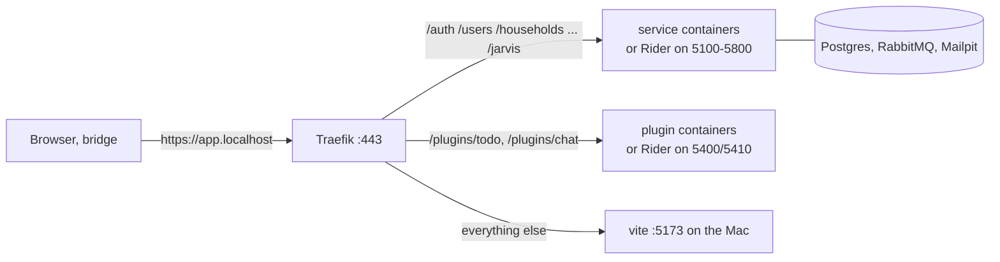

# Local development

How to run the whole of HomeApps on your own machine at **https://app.localhost**, work on one service from Rider,
and try plugins (Todo, Chat), HomeMix add-ons, JARVIS and the voice bridge against it. Building, testing and the
package rules are in [working-with-the-repo.md](working-with-the-repo.md).



## Once per machine

You need Docker, the .NET 10 SDK, Node 24 (`src/Web/.nvmrc`) and mkcert (`brew install mkcert nss`).

```bash
scripts/dev-cert.sh      # certificate for app.localhost and *.app.localhost from your own mkcert CA
cp .env.example .env     # every value has a working default; read the comments
cd src/Web && npm ci
```

The certificate is trusted by the browser, curl and .NET on this machine, so nothing needs `--insecure` or a click
through a warning. It is not in git: each machine makes its own.

In `.env` set at least `AUTH_BOOTSTRAP_EMAIL` (your address: on an empty database Auth sends it the first Owner's
invitation, which lands in Mailpit at <http://localhost:8025>).

## Every day

```bash
docker compose up -d --build     # .env names compose.dev.yaml and the "services" profile
cd src/Web && npm run dev        # the app always runs here, with hot reload
```

Open <https://app.localhost>. The rest of the local addresses:

| What | Where |
|---|---|
| Mailpit (every email) | <http://localhost:8025> |
| RabbitMQ | <http://localhost:15672> (guest / guest) |
| Traefik dashboard | <http://localhost:8080> |
| Postgres | `localhost:5432` (postgres / postgres), one database per service: `homeapps_auth`, `homeapps_accounts`, ... |

`docker compose up -d --build <service>` rebuilds one container after a change. `docker compose down` stops
everything and keeps the data; `docker compose down -v` also wipes the databases and Auth's dev signing keys.

### One service from Rider

Every service container is also published on its Rider port, so to debug one:

```bash
docker compose stop households      # then run Households.Api from Rider with the "http" profile
```

Traefik's file routes (`dynamic/dev-routes.yaml`) now send its paths to Rider, and the other services keep working,
because a service from Rider reaches the others on `localhost:<port>` (its `appsettings.Development.json`).
`docker compose start households` brings the container back; while both run, the container wins.

| Service | Port | | Service | Port |
|---|---|---|---|---|
| Auth | 5100 | | HomeMix | 5600 |
| Accounts | 5200 | | JARVIS | 5700 |
| Households | 5300 | | Devices | 5800 |
| Notifications | 5500 | | vite | 5173 |
| Todo (plugin) | 5400 | | Chat (plugin) | 5410 |

Two limits: the containers call each other by name (`http://auth:8080`, `http://households:8080`), so keep **Auth**
in its container while any other service runs in one, and JARVIS's container cannot reach a service you moved to
Rider (debug JARVIS from Rider too when you need its tools from that service).

Without any service containers (all from Rider): `docker compose up -d traefik postgres rabbitmq mailpit`.

### Service secrets

Auth knows two service clients, `jarvis-service` and `devices-service`. In development their secrets are fixed
defaults that compose gives to both Auth and the service, so there is nothing to set. If you set
`JARVIS_CLIENT_SECRET` or `DEVICES_CLIENT_SECRET` in `.env`, compose passes the same value to both sides as well.
From Rider every side reads the defaults in its `appsettings.Development.json`.

## Plugins: Todo and Chat

The plugins live in their own repositories next to this one (`../HomeApps.Todo`, `../HomeApps.Chat`). Once per
HomeApps version, pack the kit they build on:

```bash
scripts/pack.sh          # → ~/.homeapps/packages
```

**In containers**, as in production. In the plugin's folder:

```bash
ln -s ../HomeApps/.env .env               # once; the plugin reads HOMEAPPS_DOMAIN and the passwords from it
docker compose -f compose.yaml up -d --build
```

For Chat also set `CHAT_MEDIA_SIGNING_KEY` in HomeApps' `.env` (`openssl rand -base64 48`). Then list the plugins in
HomeApps' `.env`, e.g. `HOMEAPPS_PLUGINS=todo,chat`, and restart vite and the containers that read it:
`docker compose up -d homemix jarvis`. The plugin's own Traefik labels claim `/plugins/<id>` at once.

**From Rider:** run `Todo.Api` (port 5400) or `Chat.Api` (5410, needs `ffmpeg`) with the `Development` profile;
the routes are already in `dev-routes.yaml`. Stop the plugin's container first if it runs. For UI changes run
`npm run build -- --watch` in the plugin's `src/Todo.Web` or `src/Chat.Web` and reload the page.

vite reads `HOMEAPPS_PLUGINS` from `.env` too (a value in the shell wins), so the list lives in one place.
Details and troubleshooting: [plugin-todo.md](plugin-todo.md), [plugin-chat.md](plugin-chat.md), [plugins.md](plugins.md).

## HomeMix add-ons

Writing an add-on needs no HomeApps at all: `npm create @home-apps/homemix@latest my-addon`, then `npm run dev` runs a
fake HomeApps at <http://localhost:5180> ([homemix-authoring.md](homemix-authoring.md)).

To try it in the real local instance, `npm run pack` and upload `addon.zip` in a household's settings →
**Dodaj dodatek** → **Plik zip**. Packages are kept in the `homemix-packages` volume (from Rider:
`.homemix-packages/`).

The official add-ons (Pomodoro, Pogoda) are built into the HomeMix image, so the store shows them in the container.
From Rider, build them once: `homemix/official/build.sh` (into `homemix/official/dist`, which Rider's settings read).
Working on the HomeMix tooling itself (`src/Web/homemix`): [homemix.md](homemix.md).

## JARVIS

Put your Claude subscription token in `.env` (`JARVIS_CLAUDE_CODE_OAUTH_TOKEN`, from `claude setup-token`) and
`docker compose up -d jarvis`; without it he answers that he is switched off. His tools come from the services and
the plugins in `HOMEAPPS_PLUGINS`. Claude Code on your Mac can use the same tools:
`claude mcp add --transport http homeapps https://app.localhost/jarvis/mcp` ([jarvis.md](jarvis.md)).

**Voice:** `docker compose -f compose.voice.yaml up -d` starts Speaches on port 8000, which JARVIS's container
reaches at `host.docker.internal:8000` (download the models once, commands in [jarvis.md](jarvis.md)).

**Bridge and satellites** live in `../HomeApps.Desktop`:
`dotnet run --project src/Jarvis.VoiceBridge -- --server https://app.localhost`. With the mkcert certificate it no
longer needs `--insecure`. Pairing a satellite: [devices.md](devices.md). For testing smart home devices, satellites, and
continuous listening (H-8) without physical hardware, see the [Mac device emulator](../tools/mac-device-emulator/README.md) (`tools/mac-device-emulator/`).

## Tests

`dotnet test HomeApps.slnx` starts its own Postgres, RabbitMQ and Mailpit with Testcontainers; it only needs Docker
running. The web app: `npm run test:run` in `src/Web`; the end-to-end check against the running stack is in
[web.md](web.md).

## When something does not work

| What you see | Where to look |
|---|---|
| Certificate warning, or the bridge refuses the connection | `scripts/dev-cert.sh`, then `docker compose restart traefik`; Firefox needs `nss` before `mkcert -install` |
| 404 from Traefik on every path | `docker compose ps`: Traefik must run, and vite for the app itself |
| 502 on a service's path | neither its container nor Rider runs it: `docker compose ps`, `docker compose logs <service>` |
| A plugin is missing under **Aplikacje** | `curl https://app.localhost/plugins.json` must list it (restart vite after editing `.env`); its manifest must answer at `/plugins/<id>/manifest` |
| `network homeapps_default not found` in a plugin | start HomeApps first; its compose project must be named `homeapps` (it is, in `compose.dev.yaml`) |
| `required variable ... is missing` in a plugin | the `.env` link is missing, or `CHAT_MEDIA_SIGNING_KEY` for Chat |
| JARVIS cannot act for anyone (401 from Auth in `docker compose logs jarvis`), or pairing a satellite fails | a stale `.env` from production: remove `JARVIS_CLIENT_SECRET`/`DEVICES_CLIENT_SECRET`, or keep them; compose now passes them to Auth too. `docker compose up -d auth devices jarvis` |
| JARVIS says he is switched off | `JARVIS_CLAUDE_CODE_OAUTH_TOKEN` in `.env`, then `docker compose up -d jarvis` |
| No invitation email | Mailpit; `AUTH_BOOTSTRAP_EMAIL` only works on an empty `homeapps_auth` database |
