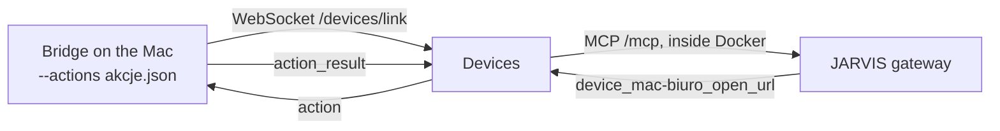

# Devices service

Devices knows which devices a person has and what each of them can do, so JARVIS can act on them: a computer running
the bridge (open a page, show a notification, say something) now, satellites such as an ESP32 in the car later. A device
connects itself, announces its actions, and Devices offers them to the JARVIS gateway as MCP tools. Plan:
`plans/features/jarvis-satellites.md` (sections 2a and 4, stage S-0).

## Run it locally

Start the infrastructure and Auth as described in [auth.md](auth.md), then run `Devices.Api` from Rider with the
`http` profile (port 5800). Traefik forwards `https://app.localhost/devices` to it (`dynamic/dev-routes.yaml`); in the
`services` profile the `devices` container does the same. In Development it applies its migrations on start (database
`homeapps_devices`). JARVIS in dev already lists it as the source `devices` (`http://localhost:5800/mcp`).

## The link `/devices/link`

A WebSocket with the person's token (`Authorization: Bearer`): a normal one or an app token from "Połączone aplikacje"
for the gateway (`https://<domain>/jarvis/mcp`, accepted through `Devices:Resource`), which is what the bridge has.

- **Device → server:** first, within 10 s, `{"type":"hello","device":"mac-biuro","kind":"computer"|"satellite",
  "actions":[{"name","description","input"(JSON schema),"readOnly","confirm"}]}`; later `{"type":"action_result",
  "id","ok","text"}`.
- **Server → device:** `{"type":"ready","deviceId"}` or `{"type":"error","code","text"}` and a close;
  `{"type":"action","id","name","input"}`, answered within `Devices:ActionTimeout` (20 s).
- **Names:** a device `^[a-z0-9][a-z0-9-]{0,19}$`, unique per person; an action `^[a-z][a-z0-9_]{0,19}$`, at most 50.
  The first `hello` registers the device; later ones refresh its actions (the "Nie pytaj" switches stay). A device is
  online only while its link is open; one link per device (a second `hello` for it is refused).

## Tools for JARVIS

The gateway reads Devices' MCP server (`/mcp`, only inside the Docker network) as the source `devices` with the prefix
`device`, so an action becomes `device_<device>_<action>`, e.g. `device_mac-biuro_open_url`. Only the person's own
online devices are listed, and only in that person's runs.

- `readOnly` actions just run.
- Other actions with `confirm` (the default) wait for a "tak" or the button, like every destructive tool (S6), unless
  the person turned on "Nie pytaj" for that action.
- `confirm: false` is for harmless changes (a notification, a sentence spoken aloud).

## API for the app

| Method | Path | What |
|---|---|---|
| GET | `/devices` | my devices with their actions and whether they are online |
| DELETE | `/devices/{id}` | turn a device off (its link is dropped and it may not connect again) |
| POST | `/devices/{id}/restore` | turn it back on |
| PUT | `/devices/{id}/actions/{action}/allow` | `{"allowed": true}` = "Nie pytaj" for this action |
| GET | `/devices/households/{householdId}` | the household's devices (any member) |
| POST | `/devices/households/{householdId}` | `{"name": "salon"}`: add a satellite (admin), answers `{deviceId, name, code, expiresAt}` |
| POST | `/devices/{id}/pairing-code` | a new code for a household device (admin); the old pairing ends |

Removing, restoring and "Nie pytaj" work on a household device for the household's admins and owner. When an account
is erased (`UserErased`), its own devices go with it; household devices it added stay with the household.

## Household devices (S-1)

A household admin adds a satellite by name and gets a one-time **pairing code**: 8 characters without look-alikes,
valid for 10 minutes, stored only as SHA-256. Names are unique in the household. Until the device pairs it cannot
connect (`devices.not_paired`). Members see the list; only admins change it; someone outside the household gets 404.
Devices asks Households for roles with the caller's own token (`Devices:HouseholdsUrl`).

JARVIS sees the online devices of every household the person is in next to their own (S3); when two have the same
name, the person's own device wins. Pairing (`/devices/pair`), the satellite's own identity as a household member and
the GUI follow in S-1b to S-1e.

## The bridge's actions

`--actions <file>` on the voice bridge connects the computer as a device. The file is a JSON array (comments allowed);
each action has `name`, `description`, `run` (a command for `/bin/sh -c`), optionally `input` (a JSON schema),
`readOnly` and `confirm`. The input reaches the command only as environment variables, `JARVIS_<FIELD>` for each field
and `JARVIS_INPUT` for the whole JSON, so quote them (`"$JARVIS_TEXT"`); never paste them into the command text. A
command has 15 s, and the first 2000 characters of its output (or of its errors when it fails) are JARVIS's answer.
Example for a Mac: `src/Jarvis/Jarvis.VoiceBridge/actions.macos.example.json`.
