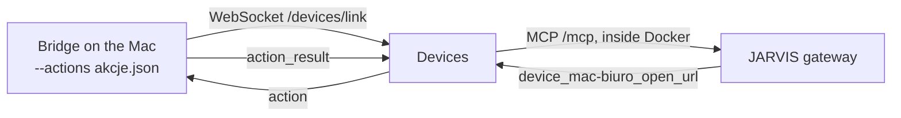

# Devices service

Devices knows which devices a person has and what each of them can do, so JARVIS can act on them: a computer running
the bridge (open a page, show a notification, say something) now, satellites such as an ESP32 in the car later. A device
connects itself, announces its actions, and Devices offers them to the JARVIS gateway as MCP tools. Plan:
`plans/features/jarvis-satellites.md` (sections 2a and 4, stage S-0).

## Run it locally

Start the infrastructure and Auth as described in [auth.md](auth.md), then run `Devices.Api` from Rider with the
`http` profile (port 5800). Traefik forwards `https://app.localhost/devices` to it (`dynamic/dev-routes.yaml`); in the
`services` profile the `devices` container does the same. In Development it applies its migrations on start (database
`homeapps_devices`). JARVIS in dev already lists it as the source `devices` (`http://localhost:5800/mcp`).

## The link `/devices/link`

A WebSocket with the person's token (`Authorization: Bearer`): a normal one or an app token from "Połączone aplikacje"
for the gateway (`https://<domain>/jarvis/mcp`, accepted through `Devices:Resource`), which is what the bridge has.

- **Device → server:** first, within 10 s, `{"type":"hello","device":"mac-biuro","kind":"computer"|"satellite",
  "actions":[{"name","description","input"(JSON schema),"readOnly","confirm"}]}`; later `{"type":"action_result",
  "id","ok","text"}`.
- **Server → device:** `{"type":"ready","deviceId"}` or `{"type":"error","code","text"}` and a close;
  `{"type":"action","id","name","input"}`, answered within `Devices:ActionTimeout` (20 s).
- **Names:** a device `^[a-z0-9][a-z0-9-]{0,19}$`, unique per person; an action `^[a-z][a-z0-9_]{0,19}$`, at most 50.
  The first `hello` registers the device; later ones refresh its actions (the "Nie pytaj" switches stay). A device is
  online only while its link is open; one link per device (a second `hello` for it is refused).

## Tools for JARVIS

The gateway reads Devices' MCP server (`/mcp`, only inside the Docker network) as the source `devices` with the prefix
`device`, so an action becomes `device_<device>_<action>`, e.g. `device_mac-biuro_open_url`. Only the person's own
online devices are listed, and only in that person's runs.

- `readOnly` actions just run.
- Other actions with `confirm` (the default) wait for a "tak" or the button, like every destructive tool (S6), unless
  the person turned on "Nie pytaj" for that action.
- `confirm: false` is for harmless changes (a notification, a sentence spoken aloud).

## API for the app

| Method | Path | What |
|---|---|---|
| GET | `/devices` | my devices with their actions and whether they are online |
| DELETE | `/devices/{id}` | turn a device off (its link is dropped and it may not connect again) |
| POST | `/devices/{id}/restore` | turn it back on |
| PUT | `/devices/{id}/actions/{action}/allow` | `{"allowed": true}` = "Nie pytaj" for this action |
| GET | `/devices/households/{householdId}` | the household's devices (any member) |
| POST | `/devices/households/{householdId}` | `{"name": "salon"}`: add a satellite (admin), answers `{deviceId, name, code, expiresAt}` |
| POST | `/devices/{id}/pairing-code` | a new code for a household device (admin); the old pairing ends |
| POST | `/devices/pair` | anonymous, `{"code": "ABCD-EFGH"}`: the satellite pairs, answers `{deviceId, householdId, name, secret}` |

In the app (S-1d): **Konto → Komputery** (`/account/devices`) lists my computers; the household's satellites are
the **Urządzenia** tab of each household (`/homes/<id>/devices`), where admins add one (the code is shown once, as
`ABCD-EFGH`), give a new code, turn it off or back on and switch "Nie pytaj" per action. The spoken PIN is set in
**Konto → Bezpieczeństwo**. The SPA never uses `/devices` itself: that prefix belongs to this service.

Removing, restoring and "Nie pytaj" work on a household device for the household's admins and owner. When an account
is erased (`UserErased`), its own devices go with it; household devices it added stay with the household.

## Household devices (S-1)

A household admin adds a satellite by name and gets a one-time **pairing code**: 8 characters without look-alikes,
valid for 10 minutes, stored only as SHA-256. Names are unique in the household. Until the device pairs it cannot
connect (`devices.not_paired`). Members see the list; only admins change it; someone outside the household gets 404.
Devices asks Households for roles with the caller's own token (`Devices:HouseholdsUrl`).

JARVIS sees the online devices of every household the person is in next to their own (S3); when two have the same
name, the person's own device wins.

### Pairing and the satellite's identity (S13)

A satellite belongs to its household but is **not a household member** (stage H-0; JARVIS reads the household's people through the internal Households endpoint, and since H-1 plugins see it as the household assistant, see below):

1. The satellite sends the code to `POST /devices/pair` (no account; the code is spent, case and dashes do not
   matter). An unknown, used or expired code is 404 `devices.pairing_expired`.
2. Devices asks Auth on the Docker network, `POST /internal/devices`, with its service client `devices-service`
   (`Devices:ClientSecret`, `DEVICES_CLIENT_SECRET` in production). Auth makes the satellite's identity (its id is the
   device's id) and hands out a **secret** once; pairing again replaces it. Only `devices-service` may do this.
3. Auth publishes `HouseholdDevicePaired` (Auth and JARVIS consume it; Households no longer does, so the satellite
   is not in the member list and does not count towards the member limit).
4. The satellite trades its secret for 15-minute tokens at `POST /auth/devices/token` `{deviceId, secret}`:
   `sub` = the device, `household_id`, `role` User, no email, `act` = `device`. Auth, Accounts and Households refuse
   its changes like any assistant's; Households answers `GET /households/{id}/members/me` for it with the household assistant's role (`Guest` or `Member` from its access level, `isAssistant: true`; 404 when the assistant is off), so plugins authorize it as before. With that token it connects to
   `/devices/link` and keeps the name its household gave it (the `device` in `hello` is ignored).
5. When JARVIS answers a satellite, Auth's delegation (`/internal/delegation`) gives him a token for the device
   instead of a person, so JARVIS acts for the satellite (not a member; its plugin access is the household assistant's level). The household's JARVIS settings also filter the tools of its session (see jarvis.md, H-2).

The Mac bridge is such a satellite after `--pair <code>` (S-1e, see [jarvis.md](jarvis.md) "The Mac bridge"): it
does steps 1 and 4 itself and keeps the secret in the Keychain.

Removing the satellite or making a new code publishes `HouseholdDeviceUnpaired`: Auth stops its secret,
JARVIS forgets the satellite's conversation. Restoring a removed satellite needs a
new code.

### Who speaks to a satellite (S4)

Each person may set a **spoken PIN** of 4–8 digits in their account: `PUT /auth/me/pin` `{pin, currentPassword}` (the
same proof as a password change; no password, then a recent sign-in), `DELETE /auth/me/pin`; `GET /auth/me` shows
`hasPin`. Auth keeps only its hash. When a satellite hears "tu Adrian, PIN 1234", JARVIS asks
`POST /internal/devices/speaker` `{clientId, clientSecret, deviceId, candidates, pin}` (any service client) and gets
`{userId}` or `{userId: null}`. Five misses lock that satellite's PIN checks for 15 minutes (423
`devices.pin_locked`); a PIN that fits two candidates is 409 `devices.pin_ambiguous` and not counted. The flow in
JARVIS: jarvis.md, "Voice".

## The bridge's actions

`--actions <file>` on the voice bridge connects the computer as a device; the file format and a Mac example are in
HomeApps.Desktop `docs/bridge.md` "Computer actions".
