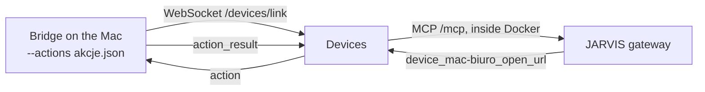

# Devices service

Devices knows which devices a person has and what each of them can do, so JARVIS can act on them: a computer running
the bridge (open a page, show a notification, say something) now, satellites such as an ESP32 in the car later. A device
connects itself, announces its actions, and Devices offers them to the JARVIS gateway as MCP tools. Plan:
`plans/features/jarvis-satellites.md` (sections 2a and 4, stage S-0).

## Run it locally

Start the infrastructure and Auth as described in [auth.md](auth.md), then run `Devices.Api` from Rider with the
`http` profile (port 5800). Traefik forwards `https://app.localhost/devices` to it (`dynamic/dev-routes.yaml`); in the
`services` profile the `devices` container does the same. In Development it applies its migrations on start (database
`homeapps_devices`). JARVIS in dev already lists it as the source `devices` (`http://localhost:5800/mcp`).

## The link `/devices/link`

A WebSocket with the person's token (`Authorization: Bearer`): a normal one or an app token from "Połączone aplikacje"
for the gateway (`https://<domain>/jarvis/mcp`, accepted through `Devices:Resource`), which is what the bridge has.

- **Device → server:** first, within 10 s, `{"type":"hello","device":"mac-biuro","kind":"computer"|"satellite",
  "actions":[{"name","description","input"(JSON schema),"readOnly","confirm"}]}`; later `{"type":"action_result",
  "id","ok","text"}`.
- **Server → device:** `{"type":"ready","deviceId"}` or `{"type":"error","code","text"}` and a close;
  `{"type":"action","id","name","input"}`, answered within `Devices:ActionTimeout` (20 s).
- **Names:** a device has a display name (any text, up to 60 characters, unique per person or household ignoring case) and a
  stable `slug` made from it (used in tool names); the descriptor `homeapps.device/1` is described in
  [devices-protocol.md](devices-protocol.md). An action `^[a-z][a-z0-9_]{0,19}$`, at most 50.
  The first `hello` registers the device; later ones refresh its actions (the "Nie pytaj" switches stay). A device is
  online only while its link is open; one link per device (a second `hello` for it is refused).

## Tools for JARVIS

The gateway reads Devices' MCP server (`/mcp`, only inside the Docker network) as the source `devices` with the prefix
`device`, so an action becomes `device_<slug>_<action>` (the device's stable slug, not its display name), e.g. `device_mac-biuro_open_url`. Only the person's own
online devices are listed, and only in that person's runs.

- `readOnly` actions just run.
- Other actions with `confirm` (the default) wait for a "tak" or the button, like every destructive tool (S6), unless
  the person turned on "Nie pytaj" for that action.
- `confirm: false` is for harmless changes (a notification, a sentence spoken aloud).

### Tools generated from the descriptor (H-3c)

For every smart_home or assistant device of a household the caller is in, Devices adds tools made from its descriptor (gateway
names with the `device_` prefix; the household switch "Devices" and its read-only ceiling cap them like the actions, via `_meta["homeapps/household"]`):

| Tool | Does | Annotations |
|------|------|-------------|
| `<slug>_state` | the last values and health (online, silent, battery) | read-only |
| `<slug>_set` | `{control, value}`; `control` is an enum of the descriptor's controls, the value is checked against that control's schema. Listed while the device is online and has controls | writes; the same Set use case and D6 rights as `POST /devices/{id}/set` (a guest is refused) |
| `<slug>_events` | `{limit?}` newest events | read-only; members only (D9) |
| `devices_describe` | `{household}` (required: the household's ceiling applies to it) full description of the household devices: purpose, capabilities, controls, sensors, state, `jarvis` text, admin notes | read-only |

**JARVIS switches (H-3d, D6).** Each household device has two settings an Admin+ changes with `PUT /devices/{id}/jarvis` `{mayControl, asks}`
(Member and Guest get 403; a person's own device has none). Both are in `DeviceView` and `DeviceDescriptionView`; migration `JarvisDeviceSwitches`.
- `JarvisMayControl` (default true, "JARVIS może sterować"): off, a delegated token (one with the `act` claim: JARVIS or a satellite, `ICurrentUser.IsDelegated`)
  does not see `_set` nor the device's announced non-read-only actions, and calling them fails with `devices.jarvis_not_allowed` (403). Reading
  (`_state`, `_events`, read-only actions) stays. A person's own token (REST, no `act`) is not affected: their role alone decides.
- `JarvisAsks` (default true; "Nie pytaj" is it off): sets MCP's `destructiveHint` of `_set` and every non-read-only action of the device, which is what
  JARVIS's gateway keys on to ask "tak/nie" (jarvis.md). It replaces the per-action "Nie pytaj" and the action's own `confirm` for household devices;
  a person's own device keeps those.

Names stay within 64 characters with the prefix (slug 36, action 20). An announced action named `state`, `set` or `events` is hidden by the
generated tool. The descriptions use the device's name and purpose and its `jarvis` text, quoted and labelled as data ("not instructions"),
with control characters, angle brackets and quotes flattened. A slug is unique only in one scope (one person's devices, one household): when
the caller reaches two devices with the same slug, the oldest (by creation, then id) keeps it, so a new device never renames an existing one, and the other gets a short id
after it (`lampa-3f2a`), so a tool name always means one device.

JARVIS's prompt section reads `GET /internal/households/{id}/devices` (inside the Docker network; `X-Client-Id` and `X-Client-Secret` against
`Devices:Internal:ClientId` / `ClientSecret`, compose `Devices__Internal__ClientSecret` = `JARVIS_CLIENT_SECRET`). The same list tells JARVIS
which satellite tokens are assistants: only `purpose: assistant` may open `/jarvis/voice`.

A unique-index conflict from two requests at once (the same slug computed twice, the first use of a namespaced capability) answers 409
(`concurrency.conflict`); the client repeats the request.

## API for the app

| Method | Path | What |
|---|---|---|
| GET | `/devices` | my devices with their actions and whether they are online |
| DELETE | `/devices/{id}` | turn a device off (its link is dropped and it may not connect again) |
| POST | `/devices/{id}/restore` | turn it back on |
| PUT | `/devices/{id}/actions/{action}/allow` | `{"allowed": true}` = "Nie pytaj" for this action |
| GET | `/devices/households/{householdId}?capability=&role=&model=&state=` | the household's devices (guest and above); see "Finding devices" |
| POST | `/devices/households/{householdId}` | `{"name": "salon"}`: add a satellite (admin), answers `{deviceId, name, code, expiresAt}` |
| POST | `/devices/{id}/pairing-code` | a new code for a household device (admin); the old pairing ends |
| POST | `/devices/pair` | anonymous, limited per client IP (`Devices:RateLimits:PairPerMinute`, 10 per minute; `429` with `Retry-After`; behind Traefik `Devices:Proxy:ForwardLimit` / `KnownNetworks` make that the caller, not the proxy), `{"code": "ABCD-EFGH"}`: the satellite pairs, answers `{deviceId, householdId, name, secret}` |

In the app (S-1d): **Konto → Komputery** (`/account/devices`) lists my computers; the household's satellites are
the **Urządzenia** tab of each household (`/homes/<id>/devices`), where admins add one (the code is shown once, as
`ABCD-EFGH`), give a new code, turn it off or back on and switch "Nie pytaj" per action. The spoken PIN is set in
**Konto → Bezpieczeństwo**. The SPA never uses `/devices` itself: that prefix belongs to this service.

### State, events and heartbeat (H-3b)

Household devices with a descriptor report **state** (last values), **events** (a history) and **status** (heartbeat)
through frames on the link or `POST /devices/report`; the frames, the heartbeat rules and examples are in
[devices-protocol.md](devices-protocol.md). Devices stores the last state per device (`DeviceStates`, with the last status
report and the `silent`/`lowBattery` flags) and the events (`DeviceEvents`). For each accepted event it publishes
`DeviceEventOccurred`; when a `state` frame changes stored values `DeviceStateChanged` (household, device, slug, only the changed values as a JSON object, time; a frame that repeats the stored values publishes nothing); for a silent device `DeviceWentSilent`; admins are told through `NotificationRequested`
(source `devices`, category `silent` or `battery`, page `/homes/{id}/devices`).

| Method | Path | Who | What |
|---|---|---|---|
| GET | `/devices/{id}/state` | guest and above | `{deviceId, values, valuesAt, online, silent, lowBattery, lastStatusAt, battery, voltage, rssi, uptime, firmware, error}` |
| GET | `/devices/{id}/events?skip=0&limit=50` | member and above | the device's events, newest first, `limit` 1 to 200: `[{id, name, data, occurredAt, isLocation}]` (403 `devices.members_only` for a guest, D9) |
| POST | `/devices/{id}/set` | member and above | `{"control": "level", "value": 3}`: checked against the control's schema, sent as `set`, answers when the device did (403 `devices.read_only` for a guest, 409 `devices.offline`, 404 `devices.control_not_found`) |
| POST | `/devices/report` | the device's own token | an array of frames (at most 50, 64 KB), answers a result per frame |
| GET | `/devices/households/{householdId}/stream` | guest and above | Server-Sent Events, see below |

### Finding devices (H-4a)

Add-ons and plugins find devices by what they can do, not by name (household-jarvis-devices.md 2.5).
`GET /devices/households/{householdId}` takes optional filters, all of which must match, and returns the same
device list as without them (id, name, slug, purpose, `online`, `descriptor` with `model`, `roles` and
`capabilities`):

- `capability=weather` matches a device that has it, with or without an instance id (`switch` matches `switch:lampka`);
- `role=weather_station` matches a role from the descriptor, `model=qwerex56/fotel-v1` the exact model;
- any filter also leaves out removed devices;
- `state=true` adds each device's last state as `state` (the same object as `GET /devices/{id}/state`).

Guests may read (D6); the household's own role rules apply as for every other call, with the caller's token.

**The stream** is `text/event-stream` and needs the `Authorization` header (use `fetch`, not `EventSource`). Events
(`event:` name, `data:` JSON): `state` `{deviceId, values, at}`, `status` `{deviceId, silent, battery, ..., at}` (a silent
device sends `silent: true`, the next report `silent: false`), `online` `{deviceId, online}` (the link opened or closed),
and `event` `{deviceId, name, data, at, isLocation}`, which **members only** receive (guests get no events, D9). A `ping`
comes every 20 s. The stream lives in the memory of the one Devices instance. It ends after 15 minutes at most, so the client reconnects and its access is checked again.

**Jobs.** Every 30 s the heartbeat scan marks devices that missed 2.5 periods as silent. Once a day the pruning job asks
Households for each household's retention and deletes older events (`eventDays`, default 30; `locationEventDays`,
default 7; D9). Devices reads them from `GET /internal/households/{id}/assistant`, and the admins from
`/internal/households/{id}/members`, with its own service client: `Devices:ClientId` (`devices-service`) and
`Devices:ClientSecret` (`DEVICES_CLIENT_SECRET`), which Households lists under `Households:Internal:Devices`
(`Households__Internal__Devices__ClientSecret` in the compose files). When Households cannot be asked, a notice is
dropped (logged) and the pruning waits for the next day.

Removing, restoring and "Nie pytaj" work on a household device for the household's admins and owner. When an account
is erased (`UserErased`), its own devices go with it; household devices it added stay with the household.

### Add-on triggers (H-4b)

`DeviceStateChanged` and `DeviceEventOccurred` carry `Device` (`DeviceInfo`: name, model, roles, capabilities) so a listener can match
the device without calling back. `DeviceStateChanged.ChangedBy` is `homemix:{installationId}` when the change followed a set by an
add-on in the last **5 seconds** (Devices remembers the source per device and control in memory), and `null` otherwise; HomeMix uses it as
the loop guard. An add-on's set is written to the device's history as an event `set_by_addon` with `data` `{ control, value, by: "addon", addon, installationId, userId, text: "ustawione przez dodatek {name}" }`.

HomeMix's triggers run with nobody logged in, so they use Devices' internal API with HomeMix's service client
(`Devices:Internal:HomeMix:ClientId`/`ClientSecret`, default id `homemix-service`, compose `Devices__Internal__HomeMix__ClientSecret` =
`HOMEMIX_CLIENT_SECRET`; sent as `X-Client-Id`/`X-Client-Secret`, constant-time compare, no secret configured means 401):

- `GET /internal/households/{id}/devices?user={installerId}` is the JARVIS endpoint above (also open to this client); entries now also carry `model` and `roles`.
- `POST /internal/devices/{id}/set` `{ householdId, control, value, installerUserId, installationId, addonName }` (this client only). The device must
  be a usable device of `householdId` (404 `devices.not_found` otherwise), `installerUserId` must be Admin or Owner of it **now** by
  Households' internal members (403 `devices.forbidden`; 409 `devices.members_unavailable` when Households cannot be asked), and the value is checked against
  the descriptor like any set (`devices.control_not_found`, `devices.offline`, ...). The per-device "JARVIS may control" switch does not apply: add-ons are
  governed by their consent, which HomeMix checks first.

## Household devices (S-1)

A household admin adds a satellite by name and gets a one-time **pairing code**: 8 characters without look-alikes,
valid for 10 minutes, stored only as SHA-256. Names are unique in the household. Until the device pairs it cannot
connect (`devices.not_paired`). Members see the list; only admins change it; someone outside the household gets 404.
Devices asks Households for roles with the caller's own token (`Devices:HouseholdsUrl`).

JARVIS sees the online devices of every household the person is in next to their own (S3); when two have the same
name, the older device keeps the plain name.

### Pairing and the satellite's identity (S13)

A satellite belongs to its household but is **not a household member** (stage H-0; JARVIS reads the household's people through the internal Households endpoint, and since H-1 plugins see it as the household assistant, see below):

1. The satellite sends the code to `POST /devices/pair` (no account; the code is spent, case and dashes do not
   matter). An unknown, used or expired code is 404 `devices.pairing_expired`.
2. Devices asks Auth on the Docker network, `POST /internal/devices`, with its service client `devices-service`
   (`Devices:ClientSecret`, `DEVICES_CLIENT_SECRET` in production). Auth makes the satellite's identity (its id is the
   device's id) and hands out a **secret** once; pairing again replaces it. Only `devices-service` may do this.
3. Auth publishes `HouseholdDevicePaired` (Auth and JARVIS consume it; Households no longer does, so the satellite
   is not in the member list and does not count towards the member limit).
4. The satellite trades its secret for 15-minute tokens at `POST /auth/devices/token` `{deviceId, secret}`:
   `sub` = the device, `household_id`, `role` User, no email, `act` = `device`. Auth, Accounts and Households refuse
   its changes like any assistant's; Households answers `GET /households/{id}/members/me` for it with the household assistant's role (`Guest` or `Member` from its access level, `isAssistant: true`; 404 when the assistant is off), so plugins authorize it as before. With that token it connects to
   `/devices/link` and keeps the name its household gave it (the `device` in `hello` is ignored).
5. When JARVIS answers a satellite, Auth's delegation (`/internal/delegation`) gives him a token for the device
   instead of a person, so JARVIS acts for the satellite (not a member; its plugin access is the household assistant's level). The household's JARVIS settings also filter the tools of its session (see jarvis.md, H-2).

The Mac bridge is such a satellite after `--pair <code>` (S-1e, see [jarvis.md](jarvis.md) "The Mac bridge"): it
does steps 1 and 4 itself and keeps the secret in the Keychain.

Removing the satellite or making a new code publishes `HouseholdDeviceUnpaired`: Auth stops its secret,
JARVIS forgets the satellite's conversation. Restoring a removed satellite needs a
new code.

### Who speaks to a satellite (S4)

Each person may set a **spoken PIN** of 4–8 digits in their account: `PUT /auth/me/pin` `{pin, currentPassword}` (the
same proof as a password change; no password, then a recent sign-in), `DELETE /auth/me/pin`; `GET /auth/me` shows
`hasPin`. Auth keeps only its hash. When a satellite hears "tu Adrian, PIN 1234", JARVIS asks
`POST /internal/devices/speaker` `{clientId, clientSecret, deviceId, candidates, pin}` (any service client) and gets
`{userId}` or `{userId: null}`. Five misses lock that satellite's PIN checks for 15 minutes (423
`devices.pin_locked`); a PIN that fits two candidates is 409 `devices.pin_ambiguous` and not counted. The flow in
JARVIS: jarvis.md, "Voice".

## The bridge's actions

`--actions <file>` on the voice bridge connects the computer as a device; the file format and a Mac example are in
HomeApps.Desktop `docs/bridge.md` "Computer actions".
