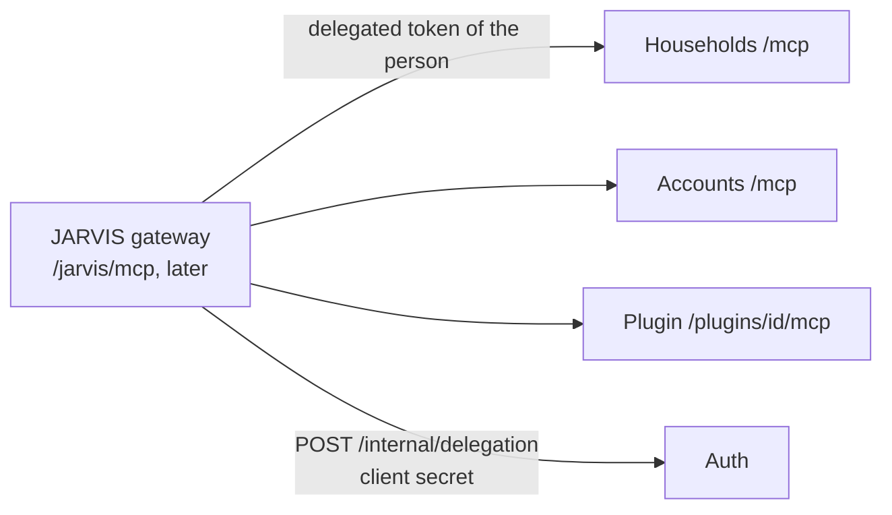

# MCP: tools for JARVIS

HomeApps services and plugins serve their use cases as **MCP tools** (Model Context Protocol), so JARVIS, or any MCP
client such as Claude Code, can act in HomeApps for a person with exactly that person's rights. The plan and the
decisions are in `plans/features/jarvis-v1.md`; this page is how it works in the code (HomeApps 2.3.0).



## A server in a service

The kit package `HomeApps.BuildingBlocks.Mcp` (official C# SDK, `ModelContextProtocol.AspNetCore`):

```csharp
builder.AddHomeAppsDefaults(typeof(Program).Assembly);
builder.AddHomeAppsMcp("homeapps-households", typeof(Program).Assembly); // every [McpServerToolType] in the assembly
...
app.UseHomeAppsDefaults();
app.MapHomeAppsMcp();                                                      // POST /mcp, stateless Streamable HTTP
```

A plugin does nothing of this by hand: when its manifest has `Mcp = new PluginMcp([...])`, `AddHomeAppsPlugin` and
`UseHomeAppsPlugin` register the server for the API assembly and map it at `/plugins/{id}/mcp`. **The registered tools
must be exactly the manifest's**, otherwise the plugin does not start.

The MCP endpoint needs a token like any other. Households and Accounts serve theirs at `/mcp`, which Traefik does not
route: only services inside the Docker network (JARVIS) reach them.

## A tool

A tool is a small class in the **Api** project, next to the endpoints of the same feature (MCP is another way in, like
HTTP). It sends **the same MediatR request** as the endpoint, so validation, `HouseholdPermissionBehavior` and the
domain rules apply unchanged, and answers with `ToolResult`:

```csharp
[McpServerToolType]
internal sealed class TaskTools(ISender sender)
{
    [McpServerTool(Name = "add_task", Destructive = false, OpenWorld = false)]
    [Description("Adds a task to a list of a household.")]
    public async Task<CallToolResult> AddTask(
        [Description("The household's id.")] Guid householdId,
        [Description("The task, as the person said it.")] string title,
        CancellationToken cancellationToken) =>
        ToolResult.From(await sender.Send(new AddTaskCommand(householdId, title), cancellationToken), _ => $"Added \"{title}\".");
}
```

Rules:

- **Names** in `snake_case`, a verb first (`add_task`, `my_tasks`). The JARVIS gateway prefixes them with the source.
- **Descriptions** say what the tool does and what each argument is, for a model that has never seen the code.
- **Annotations**: `ReadOnly = true` for queries, `Destructive = true` for anything that deletes or cannot be undone
  (JARVIS asks the person to confirm those, JV9), `OpenWorld = false` (HomeApps data only).
- **Answers are plain text**, short, no JSON and no Markdown (JARVIS may read them aloud). A failed `Result` becomes an
  error result with the API's codes: `Not allowed (plugin.forbidden): ...`, `Invalid Text: ...`.
- **Names over ids** where a person would use a name ("the shopping list", "Ewa"); when a name matches several things,
  answer with the choice instead of guessing (see `HouseholdLookup` in Households).

## Who acts: delegated tokens

JARVIS never has rights of its own. For each request it asks Auth for a **delegated token** of the person who asked:

```http
POST /internal/delegation            (Docker network only)
{ "clientId": "jarvis-service", "clientSecret": "...", "userId": "...", "channel": "chat", "reference": "..." }
→ { "accessToken": "...", "expiresAt": "..." }
```

The client must be a `Service` client in `Auth:Clients` with a `Secret` of at least 32 characters (from `.env`, never
committed). The token lives **5 minutes** and is the person's own (`sub`, `email`, `role`) plus `client_id` of the
service, `act: {"sub": "jarvis-service"}` (RFC 8693) and `amr: ["delegated"]`. Every delegation is logged by Auth.
A disabled or erased account gets none. A `Service` client can never sign anyone in.

## What an assistant may not do

`UseHomeAppsDefaults` runs an **assistant guard** right after authorization (`AssistantGuardOptions`):

| Service | Token with `act` |
|---|---|
| Auth, Accounts, Households | reads (GET, HEAD, OPTIONS) only; **every change answers 403 `assistant.not_allowed`** (JV13: JARVIS never changes accounts or households). The MCP endpoint is allowed (`AllowAssistant()`), its tools only read. |
| Plugins | everything the person may do, checked as usual; except **switching the plugin on or off** in a household (`DenyAssistant()`). |

People's own tokens are never affected. An endpoint can opt in or out with `.AllowAssistant()` / `.DenyAssistant()`;
a new endpoint in the core services is refused for assistants by default, so nothing gets through without a decision.

## Tools today

| Service | Tool | |
|---|---|---|
| Households | `my_households` | households of the person, role, member count, id |
| Households | `household_members(household)` | by name or id; roles for members and up, names only for a guest |
| Accounts | `my_profile` | name, email, language, time zone, date of birth |

Plugins add theirs (Todo and Chat in stage J1 of the JARVIS plan). HomeMix add-ons get theirs from the HomeMix
service, named after the add-on (`pomodoro_add_session`): [homemix.md](homemix.md#jarvis-a6-a7).

## Testing

`HomeApps.BuildingBlocks.Testing` has `TestJwt.CreateDelegatedToken`, `CreateAssistantClient` on the API factory and
`McpTestClient` (the SDK's own client over the test server):

```csharp
await using var mcp = await McpTestClient.ConnectAsync(factory.CreateAssistantClient(member), "plugins/hello/mcp");
var (text, isError) = await mcp.CallTextAsync("say_hello", new Dictionary<string, object?> { ["householdId"] = id, ["text"] = "Hej" });
```

By hand, with a token from the browser's dev tools (15 minutes) and the MCP Inspector:
`npx @modelcontextprotocol/inspector` → Streamable HTTP, `http://localhost:5300/mcp`, header
`Authorization: Bearer <token>`.
