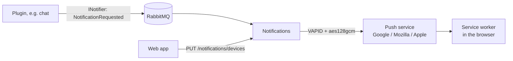

# Notifications service

Notifications sends **Web Push** notifications to the browsers and installed apps (PWA) where people turned them on.
It knows nothing about chats, tasks or households' contents: services and plugins say who should hear what, and
Notifications decides, per person, whether and where it goes. It is part of the core so every plugin gets the same
notifications, the same settings page and one place to mute them. The plan is section 1a of
`plans/features/chat-plugin.md` (Stage 0).

## Run it locally

Start the infrastructure and Auth as described in [auth.md](auth.md), then run `Notifications.Api` from Rider with the
`http` profile (port 5500). Traefik forwards `https://app.localhost/notifications` to it (`dynamic/dev-routes.yaml`);
in the `services` profile the `notifications` container does the same. In Development it applies its migrations on
start (database `homeapps_notifications`).

Without configured keys Development makes a temporary VAPID pair on every start and logs a warning: browsers then
have to turn notifications on again after each restart. For lasting keys run `scripts/generate-vapid-keys.sh` and
put both values in `.env` (or `dotnet user-secrets` as `Notifications:Vapid:PublicKey` and `PrivateKey`).

Browsers allow Web Push only on `https` (or `localhost`), so test through `https://app.localhost`.

## What a person sees

The account page has a **Powiadomienia** tab:

- **This device:** turns notifications on or off in this browser (the browser asks for permission only after this
  click) and sends a test notification. On an iPhone or iPad notifications work only in the app added to the home
  screen (iOS 16.4 or newer); the page says so instead of offering the switch.
- **Settings:** whether the text shows on the lock screen (on by default; off shows "Nowe powiadomienie" and the
  text only in the app) and **quiet hours** (for example 22:00–07:00 in the browser's time zone; nothing arrives then).
- **Households and apps:** mute a whole household, or one app (plugin) in a household.
- **Devices:** every browser with notifications on, to remove the ones no longer used.

Signing out forgets this browser's device first, so the next person on it does not get my notifications. After
signing in, a browser that still has a subscription registers it again for whoever is signed in now.

Clicking a notification opens its page in the app, or focuses an open window and moves it there. A notification for
the page already open and visible is not shown.

## Endpoints

Every endpoint needs an access token from Auth and works on the caller's own data. Errors are
`application/problem+json` with a `code`.

| Endpoint | What it does |
| --- | --- |
| `GET /notifications/vapid-public-key` | `{ publicKey }`: the key browsers subscribe with. |
| `PUT /notifications/devices` `{ endpoint, keys: { p256dh, auth } }` | Registers this browser (the body of `PushSubscription.toJSON()`); the `User-Agent` header names it. The same endpoint again only refreshes it; an endpoint another person had moves to me. At most 10 devices, the least recently used goes. `{ id }`. |
| `DELETE /notifications/devices?endpoint=` | Forgets this browser (turning off, signing out). |
| `DELETE /notifications/devices/{id}` | Removes a device from the list. `404 notifications.device_not_found`. |
| `GET /notifications/settings` | `{ showPreview, quietHours, mutes, devices }`. |
| `PUT /notifications/settings` `{ showPreview, quietHours: { from, to, timeZone } \| null }` | `from`/`to` as `HH:mm`, `timeZone` IANA. |
| `PUT /notifications/mutes` `{ householdId, source }` | Mutes a household (`source` null) or one plugin in it (`source` = plugin id). |
| `DELETE /notifications/mutes?householdId=&source=` | Unmutes. |
| `POST /notifications/test` | A test notification to all my devices, ignoring mutes. `{ delivered, gone, failed, skipped }`; `409 notifications.no_devices` without devices. |

## Sending a notification

HomeMix add-ons send theirs with `notify.push` ([homemix.md](homemix.md)): the source is the add-on's id and the
category `addon`. A plugin declares its kinds of notifications in the manifest and sends them with `INotifier`
([plugins.md](plugins.md#notifications)). A core service publishes `NotificationRequested`
(`src/Contracts/HomeApps.Contracts/Notifications`) itself:

| Field | |
| --- | --- |
| `UserIds` | Who should hear it. The sender decides, e.g. the chat room's members without the author. |
| `Source`, `Category` | The plugin id (`"chat"`) and a category from its manifest (`"message"`). |
| `Title`, `Body` | Plain text; cut to 100 and 300 characters. |
| `Url` | The app page it opens, starting with `/`, e.g. `/homes/{id}/apps/chat/rooms/{room}`. |
| `HouseholdId` | Lets people mute the household or the plugin in it. |
| `Tag` | Notifications with the same tag replace each other (one per chat room instead of fifty). |
| `BodyWhenHidden` | The text for people who hide previews; default "Nowe powiadomienie". |
| `Urgency` | `Normal`, or `High` for something that should wake a phone. |

For each person Notifications checks, in this order: no devices, the household or the plugin muted, quiet hours. If
none applies, every device gets the notification. A device whose subscription expired (`404`/`410` from the push
service) is removed. Push services keep an undelivered notification for 24 hours.

## Configuration

| Key | What it is |
| --- | --- |
| `ConnectionStrings:Database` | Notifications' own Postgres database. |
| `RabbitMq:*`, `Messaging:Transport` | The broker. |
| `Jwt:Authority`, `Jwt:Issuer`, `Jwt:RequireHttpsMetadata` | As in [accounts.md](accounts.md). |
| `Notifications:Vapid:PublicKey`, `PrivateKey` | The VAPID pair from `scripts/generate-vapid-keys.sh` (`NOTIFICATIONS_VAPID_*` in compose). Required in Production. Keep them: new keys mean every device has to turn notifications on again. |
| `Notifications:Vapid:Subject` | How push services can reach the instance's admin, `mailto:` or `https:` (default in compose: the site's address). |

The server must reach the push services over HTTPS: `fcm.googleapis.com` (Chrome, Edge, Android),
`updates.push.services.mozilla.com` (Firefox) and `web.push.apple.com` (Safari, iPhone).

## Events

Notifications consumes `NotificationRequested`, `UserDisabled` (forgets the person's devices) and `UserErased`
(removes everything about the person). It publishes nothing.

## Tests

`Notifications.Domain.Tests` needs nothing. `Notifications.Api.Tests` runs on a real Postgres
(`NOTIFICATIONS_TEST_DATABASE`, otherwise Testcontainers) with a fake push sender, so nothing leaves the machine.
The plugin side (`INotifier`, manifest categories) is tested in `HomeApps.Plugins.Tests`.
