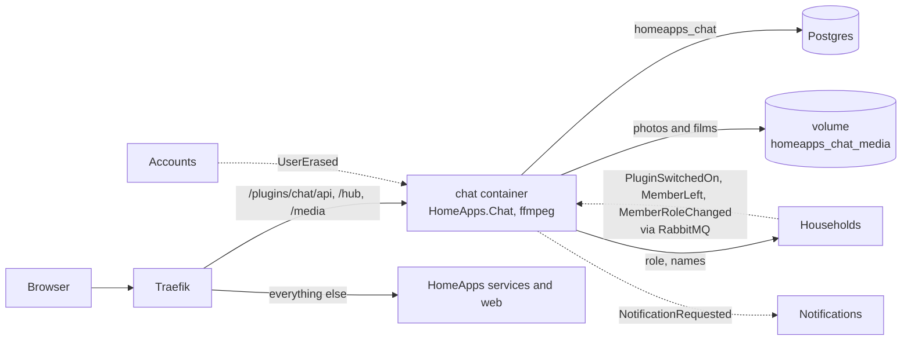

# The chat plugin in HomeApps

How to add **Czat** (conversations of a household: the whole household's "Dom", rooms of chosen people and direct
conversations; text with Markdown, photos and films up to 30 s and 20 MB) to a HomeApps instance, check that it works
and back it up. The plugin lives in its own repository, `HomeApps.Chat`, next to this one
(`~/Documents/RiderProjects/HomeApps.Chat`); its plan, decisions and API are in that repo's `docs/plan.md` and
`README.md`. The general contract between HomeApps and any plugin is [plugins.md](plugins.md); the steps are the same
as for [Todo](plugin-todo.md), plus a volume for the files and a signing key.

This covers Chat 1.0 without the MCP tools for JARVIS, which come after 1.0 (stage C5).



## What it needs from HomeApps

| | |
|---|---|
| HomeApps | **2.2.0** or newer (realtime hub, `accessToken()` in the SDK, member names for guests, push notifications) |
| Network | HomeApps' Docker network `homeapps_default` (the default of `compose.prod.yaml`, project name `homeapps`) |
| Postgres | its own database `homeapps_chat` on HomeApps' Postgres, created by the plugin on its first start |
| RabbitMQ | HomeApps' broker, the same user; queues are prefixed with `chat` |
| Auth | tokens checked against `http://auth:8080` inside the network, issuer `https://${HOMEAPPS_DOMAIN}` |
| Households | `http://households:8080` for the caller's role and the members' names |
| Notifications | push notifications for new messages go through it (people mute the chat per household there) |
| Web app | `HOMEAPPS_PLUGINS=chat` in `.env` (with Todo: `todo,chat`) |
| Disk | the volume `homeapps_chat_media`: up to 10 GB per household by default (`CHAT_STORAGE_BYTES_PER_HOUSEHOLD`) |

The image carries `ffmpeg` (films are checked and their metadata, GPS included, is dropped) and is about 400 MB.

## Adding it to a running instance

On the machine that runs HomeApps (both repositories side by side):

```bash
# 1. The kit as packages, once per HomeApps version (in HomeApps): fills ~/.homeapps/packages.
scripts/pack.sh

# 2. The signing key for links to photos and films, once, into HomeApps' .env:
echo "CHAT_MEDIA_SIGNING_KEY=$(openssl rand -base64 48)" >> .env

# 3. The plugin (in HomeApps.Chat): link HomeApps' .env once, then name the file in every compose command there.
ln -s ../HomeApps/.env .env
docker compose -f compose.yaml up -d --build

# 4. Tell the web app (in HomeApps): add the id to .env, then recreate the web container.
#    HOMEAPPS_PLUGINS=todo,chat
docker compose -f compose.prod.yaml up -d web
```

The image does not need Node: the UI build is committed in `src/Chat.Api/wwwroot/ui`. Always name the file
(`-f compose.yaml`) in HomeApps.Chat, for the same reason as with Todo (the linked `.env` may set `COMPOSE_FILE`).

The signing key only protects links: each photo link is valid for one to two hours. Changing the key is harmless
(open pages fetch new links), losing it too; it does not encrypt anything.

**Behind the Cloudflare Tunnel** nothing changes: the hub uses WebSocket, which Traefik and the tunnel pass through, and
a 20 MB upload is far below Cloudflare's 100 MB limit. If WebSocket is ever blocked, SignalR falls back to long polling
by itself.

## Switching it on in a household

1. As the household's **Admin or Owner**: the household, **Ustawienia**, **Aplikacje**, switch **Czat** on.
2. The household gets a **Czat** tab (`/homes/{id}/apps/chat`) and the **Czat** widget on its page. Not on the wall
   tablet (`/wall`): whoever walks by would read the family's messages (decision C12).
3. The first switch-on creates the conversation **Dom** for everyone in the household. Switching off hides the plugin
   and keeps everything.

Who may do what (household roles):

| | Guest | Member | Admin, Owner |
|---|---|---|---|
| Read "Dom" (from the day they joined) and rooms they were added to | yes | yes | yes |
| Write, react, send photos and films, reply, edit and delete own messages | | yes | yes |
| Direct conversations, new rooms, adding people to rooms | | yes | yes |
| Delete anyone's message in "Dom" | | | yes |
| Switch the plugin on and off | | | yes |

Rooms and direct conversations are seen only by their participants, the Owner included. A room's keeper (whoever
made it) renames it, removes people and archives it; a keeper who leaves names the next one.

## Checking that it works

1. `https://<domain>/plugins/chat/manifest` answers with `"id":"chat"` and `"realtime":"/plugins/chat/hub"`.
2. As the household's Owner: switch it on. **Czat** opens on **Dom**.
3. Open the chat in two browsers as two people. Text written in one appears in the other without a reload, with
   "… pisze" just before. A photo and a short film arrive the same way; the film plays.
4. A film longer than 30 s is refused before it is sent.
5. On a phone: the list of conversations, then the conversation on the whole screen; the camera button opens the
   camera. A push notification for a message opens that conversation.
6. As a Guest: "Dom" is readable from the day they joined, there is no text field.

Steps 1 to 4 and 6 were run in a browser against `compose.prod.yaml` + `compose.smoke.yaml` (after `scripts/smoke.sh`
passed) with the plugin started as above; push on a real phone is yours to try.

## Backups

Messages are in Postgres (`homeapps_chat`, taken by `pg_dumpall` with everything else); photos and films are only in
the volume `homeapps_chat_media`. Back up both, encrypted:
[deployment.md, "Encrypted backups"](deployment.md#encrypted-backups-with-the-chat-plugin).

## Updating and removing

```bash
# Update (in HomeApps.Chat): migrations run when the new container starts; the volume stays.
git pull
docker compose -f compose.yaml up -d --build
```

To remove the plugin: take `chat` out of `HOMEAPPS_PLUGINS` and recreate `web`, then
`docker compose -f compose.yaml down` in HomeApps.Chat. The data stays in `homeapps_chat` and the volume until you
drop them (`dropdb -U homeapps homeapps_chat` in HomeApps' postgres container, `docker volume rm homeapps_chat_media`).

## When something does not work

| What you see | Where to look |
|---|---|
| `required variable CHAT_MEDIA_SIGNING_KEY is missing` | step 2; the key must have at least 32 characters |
| No **Czat** under **Aplikacje** | `curl https://<domain>/plugins.json` must list `chat`; the manifest must answer; `docker compose -f compose.yaml logs chat` |
| Messages appear only after a reload | the hub: in the browser's network tab `/plugins/chat/hub` should switch to WebSocket (101); the page still catches up every minute without it |
| Photos never stop "Sprawdzanie…" | `docker compose -f compose.yaml logs chat` for ffmpeg errors; the volume must be writable by user 1654 |
| "W tym domu zabrakło miejsca na zdjęcia i filmy" (`chat.storage_full`) | the household reached its limit; delete old films or raise `CHAT_STORAGE_BYTES_PER_HOUSEHOLD` |
| 401 from `/plugins/chat/...` | `HOMEAPPS_DOMAIN` must be the public address (the tokens' issuer) |
| No push notifications | Notifications' own checks ([notifications.md](notifications.md)); a conversation open on screen or muted sends none |

## Development from an IDE

Run HomeApps in development as usual ([working-with-the-repo.md](working-with-the-repo.md)), then:

1. In HomeApps.Chat: `src/Chat.Api` on port **5410** (`Development`, needs `ffmpeg` on `PATH`); files go to
   `src/Chat.Api/media`.
2. In HomeApps: `dynamic/plugin-chat.yaml` with the route from [plugins.md](plugins.md), "From an IDE", for
   `/plugins/chat` to `http://host.docker.internal:5410`.
3. In `src/Web`: `HOMEAPPS_PLUGINS=chat npm run dev`.
4. UI changes: `npm run build -- --watch` in HomeApps.Chat's `src/Chat.Web` and reload the page.
