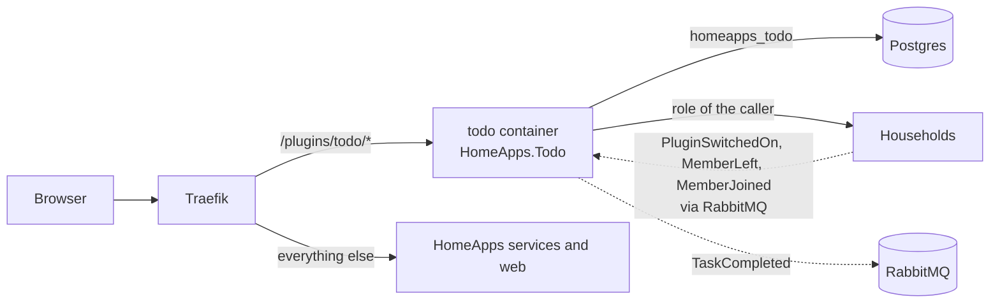

# The Todo plugin in HomeApps

How to add the first plugin, **Todo** ("Zadania": shared and private task lists of a household), to a HomeApps
instance and check that it works. The plugin lives in its own repository, `HomeApps.Todo`, next to this one
(`~/Documents/RiderProjects/HomeApps.Todo`); its own plan and API are in that repo's `docs/plan.md` and `README.md`.
The general contract between HomeApps and any plugin is [plugins.md](plugins.md).

This covers Todo 1.0 without the e-paper screen and the MCP tools for JARVIS, which come later (stage T4).



## What it needs from HomeApps

| | |
|---|---|
| HomeApps | **2.1.0** or newer (the manifest says `requires.homeApps: 2.1.0`; an older web app shows it as needing an update and never loads it) |
| Network | HomeApps' Docker network `homeapps_default` (the default of `compose.prod.yaml`, project name `homeapps`) |
| Postgres | its own database `homeapps_todo` on HomeApps' Postgres, created by the plugin on its first start |
| RabbitMQ | HomeApps' broker, the same user; queues are prefixed with `todo` |
| Auth | tokens checked against `http://auth:8080` inside the network, issuer `https://${HOMEAPPS_DOMAIN}` |
| Households | `http://households:8080` for the caller's role; its events for switching on and members leaving |
| Web app | `HOMEAPPS_PLUGINS=todo` in `.env`, so `/plugins.json` lists it |

Nothing in HomeApps changes for Todo apart from that one `.env` line.

## Adding it to a running instance

On the machine that runs HomeApps (both repositories side by side):

```bash
# 1. The kit as packages, once per HomeApps version (in HomeApps): fills ~/.homeapps/packages,
#    which the plugin's image build reads.
scripts/pack.sh

# 2. The plugin (in HomeApps.Todo). It uses HomeApps' .env for the domain and the passwords: link it once
#    (.env is ignored by git there too), then every compose command there works without extra flags.
ln -s ../HomeApps/.env .env
docker compose up -d --build

# 3. Tell the web app (in HomeApps): add the id to .env, then recreate the web container.
#    HOMEAPPS_PLUGINS=todo        (comma-separated when there are more: todo,weather)
docker compose -f compose.prod.yaml up -d web
```

`scripts/pack.sh` needs the .NET SDK on that machine; when it runs elsewhere, copy `~/.homeapps/packages` over or
point `HOMEAPPS_PACKAGES` at the folder for step 2. The image does not need Node: the plugin's UI build is committed
in `src/Todo.Api/wwwroot/ui`.

The order of steps 2 and 3 does not matter. A plugin listed in `HOMEAPPS_PLUGINS` that is not running is simply left
out of the app until it answers.

**Behind the Cloudflare Tunnel** nothing changes: the plugin's router uses the `websecure` entrypoint like every
service, and `compose.tunnel.yaml` keeps that name. Use the same `.env` (with `COMPOSE_FILE` set, step 3 is plain
`docker compose up -d web`).

**With the smoke stack** (`compose.smoke.yaml`, [deployment.md](deployment.md)) the same three steps work with
`HOMEAPPS_DOMAIN=home-apps.localhost`; that is how this page was checked.

## Switching it on in a household

Running the plugin makes it available; each household decides for itself.

1. As the household's **Admin or Owner**: the household, **Ustawienia**, section **Aplikacje**, switch **Zadania** on.
2. The household gets a **Zadania** tab (`/homes/{id}/apps/todo`) and the **Na dziś** widget on its page and on the
   wall tablet (`/wall`).
3. The first switch-on creates the shared list **Dom**. Switching off hides the plugin and keeps its data; switching
   on again shows the same lists.

Who may do what (household roles; the server role does not matter here):

| | Guest | Member | Admin, Owner |
|---|---|---|---|
| See shared lists and their tasks | yes | yes | yes |
| Add, edit, tick off and move tasks; own private lists | | yes | yes |
| Rename, archive and delete shared lists; delete anyone's task on them | | | yes |
| Switch the plugin on and off | | | yes |

A private list is seen only by its owner, whatever the role. Guests see no names of assignees, because Households
shows the member list to Members and up only.

## Checking that it works

1. `https://<domain>/plugins/todo/manifest` answers with `"id":"todo"` (no sign-in needed).
2. As the household's Owner: switch it on (above). **Zadania** opens with the list **Dom**.
3. Add a few tasks (title and Enter), give one today's date in the side panel, tick one off. After a reload everything
   is still there and the ticked task sits under **Zrobione**.
4. The household's page shows **Na dziś** with the task due today; so does `/wall`.
5. As a Member, on a phone: the lists are in a dropdown, adding works, the list menu (⋮) is not there for shared lists.
6. As a Guest: the lists are readable, nothing can be added or ticked off, a note says so.
7. Remove a member from the household: tasks assigned to them lose the assignee; their private lists go to the archive
   and are deleted after 30 days unless they come back.

Steps 1 to 5 were run in a browser against `compose.prod.yaml` + `compose.smoke.yaml` (after `scripts/smoke.sh`
passed) with Todo started as above.

## Updating and removing

```bash
# Update (in HomeApps.Todo): migrations run when the new container starts.
git pull
docker compose up -d --build
```

A new HomeApps kit version needs `scripts/pack.sh` again before the plugin's build.

To remove the plugin: take `todo` out of `HOMEAPPS_PLUGINS` and recreate `web`, then
`docker compose down` in HomeApps.Todo. Its data stays in `homeapps_todo` (and in
HomeApps' backups, since `pg_dumpall` takes every database) until you drop it:
`docker compose -f compose.prod.yaml exec postgres dropdb -U homeapps homeapps_todo`.

## When something does not work

| What you see | Where to look |
|---|---|
| No **Zadania** under **Aplikacje** | `curl https://<domain>/plugins.json` must list `todo` (recreate `web` after changing `.env`); the manifest URL above must answer; `docker compose logs todo` in HomeApps.Todo |
| **Zadania** marked as needing a newer HomeApps | the instance is older than 2.1.0 |
| `required variable ... is missing` from compose in HomeApps.Todo | the `.env` link is missing (step 2) |
| `network homeapps_default not found` when starting the plugin | HomeApps is not running, or runs under another compose project name |
| The switch is greyed out | only Admins and the Owner of that household switch plugins |
| 401 from `/plugins/todo/api/...` | `HOMEAPPS_DOMAIN` in the `.env` given to the plugin must be the public address (the tokens' issuer) |
| 403 or "plugin disabled" in a household | the plugin is off in that household, or the role is too low (table above) |
| The plugin does not start: database errors | `POSTGRES_USER`/`POSTGRES_PASSWORD` must be HomeApps': is `.env` in HomeApps.Todo the link to HomeApps' `.env`? |

## Development from an IDE

Run HomeApps in development as usual ([working-with-the-repo.md](working-with-the-repo.md)), then:

1. In HomeApps.Todo: `src/Todo.Api` on port **5400** (`Development`); database and migrations are created on start.
2. In HomeApps: `dynamic/plugin-todo.yaml` with the route from [plugins.md](plugins.md), "From an IDE".
3. In `src/Web`: `HOMEAPPS_PLUGINS=todo npm run dev`.
4. UI changes: `npm run build -- --watch` in HomeApps.Todo's `src/Todo.Web` and reload the page.
