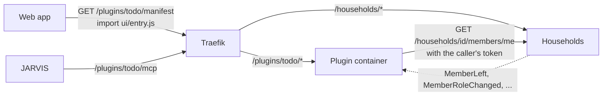

# Plugins

Apps beyond the core (todo lists, shopping, weather, news, pomodoro) are **plugins**: separate services in their own
repositories, built on the same kit as Auth, Accounts and Households, switched on per household. HomeApps itself knows
nothing about any particular plugin. This page is the contract between the two sides; the reasons are in
`plans/ideas/jarvis-hub.md` (9b) and `plans/features/todo-plugin.md`.



## What a plugin is

- A .NET service with the usual four layers (see [how a service is built](how-a-service-is-built.md)) that references
  the kit as NuGet packages instead of projects: `HomeApps.Plugins.Hosting` brings everything else with it.
- Everything it serves lives under **`/plugins/{id}`**. Traefik routes that prefix to the plugin and does not strip
  it; the plugin sets it as its path base, so it also answers without the prefix inside the Docker network.
- It has **its own database** on the shared Postgres (`homeapps_{id}`) and its own queues on the shared RabbitMQ,
  prefixed with its id.
- It keeps **no copy of users or memberships.** It asks Households for the caller's role (cached for a minute,
  dropped at once when Households publishes a change) and stores only user ids.
- It describes itself in a **manifest**: what it is, who may do what, where its API, UI, screens and MCP server are.

## The manifest

Declared once in code as a `PluginManifest` and checked when the plugin starts (`PluginManifestValidator`: every
problem at once). Clients read it as JSON at `GET /plugins/{id}/manifest`, anonymously, with every path made absolute.

```csharp
public static PluginManifest Manifest { get; } = new()
{
    Id = "todo",                              // also the path prefix and the queue prefix
    Version = "1.0.0",
    MinHomeAppsVersion = "2.1.0",             // the web app skips the plugin on an older HomeApps
    Name = new LocalizedText("Zadania", "Tasks"),
    Icon = "pi-check-square",                 // PrimeIcons
    Scopes = [DataScope.HouseholdUser],
    Enablement = new PluginEnablementRule(HouseholdRole.Admin),
    Permissions =
    [
        new PluginPermission("tasks.read", HouseholdRole.Guest),
        new PluginPermission("tasks.write", HouseholdRole.Member),
    ],
    Ui = new PluginUi
    {
        Routes = [new PluginRoute("", new LocalizedText("Zadania", "Tasks"))],
        Widgets = [new PluginWidget("today", new LocalizedText("Na dziś", "Today"), WidgetSize.Medium, [WidgetPlace.Household, WidgetPlace.Wall])],
    },
    Display = [new DisplayScreen("today", new LocalizedText("Na dziś", "Today"), "households/{householdId}/display/today", 300)],
    Mcp = new PluginMcp(["add_task", "my_tasks", "complete_task"]),
    Events = new PluginEvents([typeof(TaskCompleted)], [typeof(MemberLeft)]),
};
```

What clients get (abridged):

```json
{
  "manifestVersion": 1,
  "id": "todo",
  "version": "1.0.0",
  "requires": { "homeApps": "2.1.0" },
  "name": { "pl": "Zadania", "en": "Tasks" },
  "icon": "pi-check-square",
  "scopes": ["HouseholdUser"],
  "enablement": { "scope": "Household", "minRole": "Admin", "path": "/plugins/todo/api/households/{householdId}/enablement" },
  "permissions": [ { "id": "tasks.read", "minRole": "Guest" }, { "id": "tasks.write", "minRole": "Member" } ],
  "endpoints": {
    "api": "/plugins/todo/api",
    "openApi": "/plugins/todo/openapi/v1.json",
    "mcp": "/plugins/todo/mcp",
    "health": "/plugins/todo/health/ready"
  },
  "ui": {
    "entry": "/plugins/todo/ui/entry.js",
    "style": "/plugins/todo/ui/entry.css",
    "routes": [ { "path": "", "title": { "pl": "Zadania", "en": "Tasks" }, "menu": true } ],
    "widgets": [ { "id": "today", "title": { "pl": "Na dziś", "en": "Today" }, "size": "Medium", "places": ["Household", "Wall"] } ],
    "settings": false
  },
  "display": [ { "id": "today", "path": "/plugins/todo/api/households/{householdId}/display/today", "refreshSeconds": 300 } ],
  "mcp": { "tools": ["add_task", "my_tasks", "complete_task"] },
  "events": { "publishes": ["HomeApps.Todo.Contracts.TaskCompleted"], "consumes": ["HomeApps.Contracts.Households.MemberLeft"] }
}
```

| Field | Meaning |
|---|---|
| `manifestVersion` | The shape of this document. It only grows by optional fields; anything else is a new version, which older web apps skip. |
| `requires.homeApps` | Oldest HomeApps version the plugin works with. |
| `scopes` | Whose data: `User`, `Household`, `Application` (whole instance) or `HouseholdUser` (in a household, but items may be private). |
| `enablement` | Who switches the plugin on in a household. Required for household data; absent means always on. |
| `permissions` | Named permissions, each with the lowest household role that has it. The web app hides what the role cannot do; the plugin checks the same thing. |
| `endpoints` | API, OpenAPI (always served, anonymous), MCP server (`null` without one) and readiness. |
| `ui` | The ES module the web app imports, its pages inside a household (`/homes/{id}/apps/{plugin}/{path}`) and its widgets with where they may stand. |
| `display` | Compact JSON for e-paper and small screens, with how often to fetch it. |
| `mcp.tools` | Tool names, so JARVIS knows what to expect before it connects. |
| `events` | Integration messages it publishes and consumes. Documentation only. |

## Switching a plugin on in a household

Every plugin with household data has the same switch, from the kit:

- `GET /plugins/{id}/api/households/{householdId}/enablement` for any member: `{ householdId, enabled, changedBy, changedAt }`.
- `PUT` the same path with `{ "enabled": true }` for `enablement.minRole` and up.

No record means off. The plugin keeps the switch in its own `PluginEnablements` table (`PluginDbContext`), so
Households stays unaware of plugins. Switching raises the domain event `PluginSwitchedOn` (with `FirstTime` on the
very first time) or `PluginSwitchedOff`; a plugin handles it to seed a household's starting data in the same transaction.

## Who may do what

A command or query about a household implements `IHouseholdRequest`:

```csharp
public sealed record AddTaskCommand(Guid HouseholdId, Guid ListId, string Title) : ICommand<Guid>, IHouseholdRequest
{
    public string Permission => TodoPermissions.Write;
}
```

`HouseholdPermissionBehavior` runs right before the handler, for HTTP and MCP alike, and answers in this order:

| Situation | Status | `code` |
|---|---|---|
| Not a member, archived household, guest access ended | 404 | `household.not_found` (as in Households: no access looks like no household) |
| The plugin is off in this household | 404 | `plugin.disabled` (the web app offers to switch it on) |
| The role is below the permission's `minRole` | 403 | `plugin.forbidden` |

A permission the manifest does not declare is a bug and throws. Rules that depend on the data itself ("only the
author sees a private list") stay in the domain; the handler can ask `IHouseholdAccess.GetRoleAsync` for the role
again, which is cached.

`IHouseholdAccess` calls Households' `GET /households/{id}/members/me` with the caller's own token, so Households
applies its own rules. Roles are cached for 60 seconds and "no access" for 5 seconds (`Plugin:AccessCacheSeconds`,
`Plugin:NoAccessCacheSeconds`); `MemberJoined`, `MemberLeft`, `MemberRoleChanged`, `OwnershipTransferred`,
`HouseholdArchived` and `HouseholdRestored` drop the cached answers at once. With several copies of one plugin running,
only one of them hears those events; the others catch up when their cache expires. When Households is down, the
plugin refuses (500) rather than guesses.

## Program.cs

```csharp
var builder = WebApplication.CreateBuilder(args);

builder.AddHomeAppsPlugin(TodoPlugin.Manifest, typeof(Program).Assembly);               // kit defaults, manifest, household access
builder.Services.AddHomeAppsPluginApplication(TodoPlugin.Manifest, typeof(TodoApplication).Assembly); // MediatR + permission check
builder.Services.AddHomeAppsPluginInfrastructure<TodoDbContext>(builder.Configuration, TodoPlugin.Manifest, typeof(TodoInfrastructure).Assembly);

var app = builder.Build();
app.UseHomeAppsPlugin();   // path base, UI files, kit pipeline, endpoints under /api, manifest, switch
await app.MigrateDatabaseOnStartupAsync<TodoDbContext>();
await app.RunAsync();
```

The DbContext derives from `PluginDbContext` instead of `HomeAppsDbContext`. Configuration:

| Key | Default | |
|---|---|---|
| `ConnectionStrings:Database` | | `Host=postgres;Database=homeapps_todo;...` |
| `Jwt:Authority`, `Jwt:Issuer` | | as for the core services |
| `RabbitMq:*` | | as for the core services |
| `Plugin:HouseholdsUrl` | `http://households:8080` | from an IDE: `http://localhost:5300` |

## UI

The plugin's UI is a small Vue project (in Todo: `src/Todo.Web`) built into the API project's `wwwroot/ui`. The kit
serves it at `/plugins/{id}/ui/` anonymously and with `Cache-Control: no-cache`, since `entry.js` keeps its name between
versions. The web app reads the manifest, imports `ui.entry`, adds `ui.style` and shows the module's pieces:

| Manifest | Module (`definePlugin`) | Where the web app shows it |
|---|---|---|
| `ui.routes[]` | `routes[path]` | a page at `/homes/{householdId}/apps/{pluginId}/{path}`; with `menu` also a tab in the household |
| `ui.widgets[]` | `widgets[id]` | a tile on the household's first page (`Household`) and on `/wall` (`Wall`) |
| `ui.settings` | `settings` | a section under "Aplikacje" in the household's settings, while the plugin is on there |
| `enablement` | | the switch under "Aplikacje", usable from `enablement.minRole` up |

Only plugins that are on in the household appear. A plugin that fails to load or throws breaks only its own piece.

```ts
// src/main.ts of the plugin's UI
import { definePlugin } from '@homeapps/plugin-sdk'
import TodayWidget from './TodayWidget.vue'

export default definePlugin({
  id: 'todo',
  routes: { '': () => import('./TasksPage.vue') },
  widgets: { today: TodayWidget },
  messages: { pl: { title: 'Zadania w {name}' } },
})
```

Inside its components the plugin calls `useHost()`: `http` (Axios with the user's token and the app's refresh),
`apiBase`, `household` (id, name, `myRole`), `user`, `can('tasks.write')` (the manifest's permissions for the role),
`t('title', { … })` (its own `messages`), `notify(...)` and `errorMessage(error)`. Widgets get `householdId` and
`place` as props.

**Shared, not bundled.** The plugin's Vite config uses `homeAppsPlugin()` from `@homeapps/plugin-sdk/vite`:

```ts
export default defineConfig({ plugins: [vue(), homeAppsPlugin({ outDir: '../Todo.Api/wwwroot/ui' })] })
```

It builds one ES module and reads `vue`, `vue-router`, `vue-i18n`, `pinia` and `@tanstack/vue-query` from the web app
(`globalThis.__HOMEAPPS_SHARED__`) instead of bundling them, so there is one Vue and one query cache. PrimeVue
components are used by name without importing them (`<Button>`, `<InputText>`, `<DatePicker>`, `<Dialog>`…; the list
is `PLUGIN_COMPONENTS` in `src/Web/src/features/plugins/shared.ts`) and carry the app's theme. A plugin's own CSS should
be scoped (`<style scoped>`); it can use the app's Tailwind classes only where the app already uses them.

**The instance's plugins** come from `/plugins.json`, an array of ids: in production the web image writes it at start
from `HOMEAPPS_PLUGINS` (`.env`, e.g. `HOMEAPPS_PLUGINS=todo`), during development `vite` serves it from the same
variable (`HOMEAPPS_PLUGINS=todo npm run dev`). A listed plugin that is not running is left out; one whose manifest
needs a newer HomeApps or has an unknown `manifestVersion` shows as such under "Aplikacje" and is never loaded.

## The kit as packages

```bash
scripts/pack.sh     # → ~/.homeapps/packages (HOMEAPPS_PACKAGES to change), version from Directory.Build.props
```

It packs `HomeApps.BuildingBlocks.*`, `HomeApps.Contracts`, `HomeApps.Plugins`, `HomeApps.Plugins.Hosting` and
`HomeApps.BuildingBlocks.Testing`, and drops that version from the local NuGet cache so a repack is picked up. It also
packs the UI side as `homeapps-plugin-sdk-<version>.tgz` (run `npm ci` in `src/Web` once first); a plugin's UI
installs it with `npm install ~/.homeapps/packages/homeapps-plugin-sdk-2.1.0.tgz`. The plugin's `nuget.config`:

```xml
<configuration>
  <packageSources>
    <add key="nuget.org" value="https://api.nuget.org/v3/index.json" />
    <add key="homeapps" value="%HOME%/.homeapps/packages" />
  </packageSources>
</configuration>
```

`tests/BuildingBlocks/HomeApps.Plugins.Hello` is the smallest working plugin and the kit's own test subject, with a UI
in `ui/` (`npm install && npm run build` there; the build in `wwwroot/ui` is committed).

## Running a plugin next to HomeApps

**In containers** (production, or development with the `services` profile): the plugin's compose file joins HomeApps'
network and claims its prefix with labels.

```yaml
services:
  todo:
    image: homeapps/todo:1.0.0
    environment:
      ConnectionStrings__Database: "Host=postgres;Database=homeapps_todo;Username=${POSTGRES_USER:-homeapps};Password=${POSTGRES_PASSWORD}"
      RabbitMq__Host: rabbitmq
      Jwt__Authority: http://auth:8080
      Jwt__Issuer: https://${HOMEAPPS_DOMAIN}
    labels:
      - "traefik.enable=true"
      - "traefik.http.routers.todo.rule=Host(`${HOMEAPPS_DOMAIN}`) && PathPrefix(`/plugins/todo`)"
      - "traefik.http.routers.todo.entrypoints=websecure"
      - "traefik.http.services.todo.loadbalancer.server.port=8080"
networks:
  default:
    name: homeapps_default
    external: true
```

**From an IDE** during development: put a route in `dynamic/plugin-todo.yaml` (ignored by git; Traefik picks it up
at once).

```yaml
http:
  routers:
    todo-host:
      rule: "Host(`app.localhost`) && PathPrefix(`/plugins/todo`)"
      priority: 100
      entryPoints: [websecure]
      service: todo-host
      tls: {}
  services:
    todo-host:
      loadBalancer:
        servers:
          - url: "http://host.docker.internal:5400"
```

Plugin ports from an IDE start at 5400 (Auth 5100, Accounts 5200, Households 5300).
