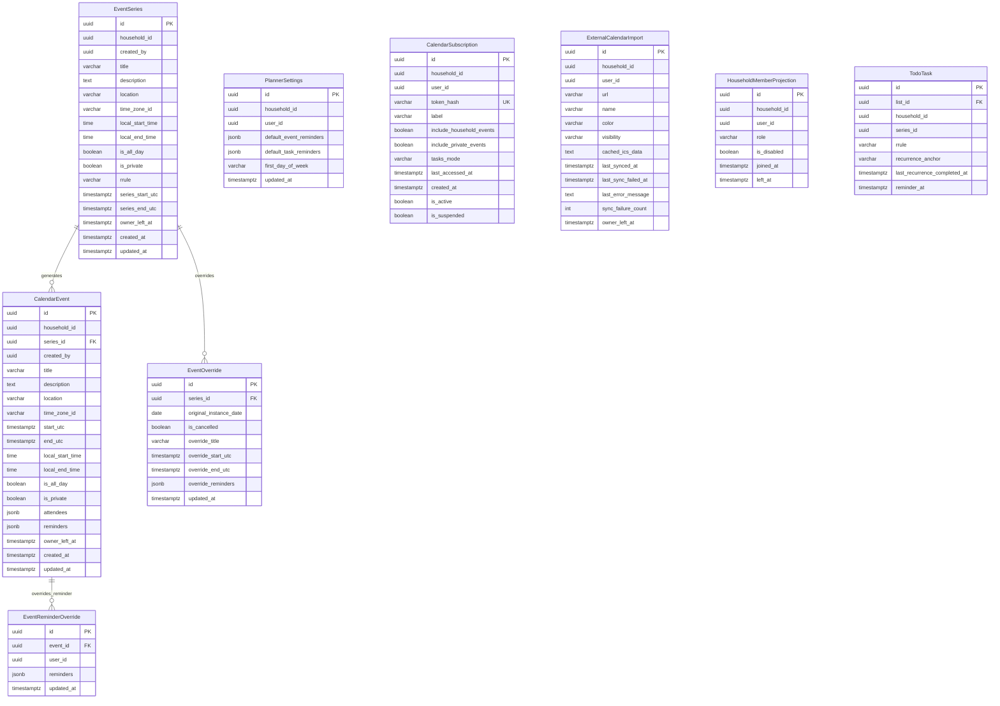

# ADR: Planer domu (kalendarz + zadania, rozbudowa pluginu Todo)

Specyfikacja: [specs/household-planner.md](household-planner.md) · Data: 2026-11-22 · Status: **accepted** (2026-11-22, po rundzie architektów i bramce Devil's Advocate; pytania Q1-Q4 potwierdzone przez właściciela wg rekomendacji)  
Zespół: Lead Backend Architect (`architect-backend`, .NET 10)  
Repozytorium docelowe: `../HomeApps.Todo` (plugin `todo`, baza `homeapps_todo`) + integracja z rdzeniem HomeApps (`src/Web`, `Notifications`, `Households`, `Accounts`).

Zakres: Pełna rozbudowa pluginu Todo o moduł Planera (wydarzenia domowe, prywatne, serie cykliczne RRULE, zadania cykliczne ze scope edycji/usuwania, przypomnienia push z per-user override, subskrypcje i importy ICS ze strażnikiem SSRF i connection pinningiem, obsługa cyklu życia konta i 30-dniowej retencji, widżet ścienny `/wall`).

Kolejność etapów: **P1 (Domain & Storage) → P2 (Events & Calendar API) → [P3 (ICS Subscriptions) || P4 (External Calendar Import & SSRF)] → P5 (Reminders & Recurring Tasks) → P6 (Web & Wall UI)**.

---

## 1. Rozstrzygnięte pytania biznesowe (Business Questions)

**Odpowiedź właściciela (2026-11-22): Q1-Q4 zgodnie z rekomendacją (opcja A).**

Poniższe pytania wynikają bezpośrednio z niejednoznaczności oraz punktów oznaczonych jako **[do potwierdzenia]** w `specs/household-planner.md`.

### Q1: Powiadomienia push dla roli Gość (Guest) [do potwierdzenia spec 2.9] — ROZSTRZYGNIĘTE: opcja A
- **Kontekst:** Specyfikacja 2.9 (wiersz 117) pyta, czy Gość uczestniczący w wydarzeniu domu lub wydarzeniu „cały dom” powinien otrzymywać powiadomienia push.
- **Opcje:**
  - *Opcja A:* Gość otrzymuje przypomnienia push o wydarzeniach, w których uczestniczy lub które są oznaczone jako „cały dom”.
  - *Opcja B:* Gość nigdy nie otrzymuje powiadomień push z pluginu Planer (tylko odczyt bierny w UI i link ICS).
- **Rekomendacja:** **Opcja A**. Technical impact: `INotifier` z modułu Notifications przyjmuje listę docelowych `UserIds`. Jeśli Gość jest jawnie dodany jako uczestnik lub wydarzenie dotyczy całego domu, pobierane są aktywne identyfikatory domowników z lokalnej tabeli projekcji `HouseholdMemberProjection`. Uwzględnienie Gościa nie narusza izolacji danych, a zapobiega pominięciu gościa w ważnych wydarzeniach rodziny.

### Q2: Model kalkulacji kolejnego terminu zadań cyklicznych [do potwierdzenia spec 2.12] — ROZSTRZYGNIĘTE: opcja A
- **Kontekst:** Specyfikacja 2.12 rozróżnia powtarzanie „od terminu” (np. wynieść śmieci co środę) oraz „od wykonania” (np. wymiana filtra wody 2 tygodnie po faktycznym zrobieniu).
- **Opcje:**
  - *Opcja A:* Wsparcie obu trybów (`RecurrenceAnchor.FromDueDate` oraz `RecurrenceAnchor.FromCompletionDate`).
  - *Opcja B:* Wyłącznie powtarzanie od sztywnego terminu (`FromDueDate`).
- **Rekomendacja:** **Opcja A**. Technical impact: Agregat `TodoTask` w `Todo.Domain` zostaje rozbudowany o enum `RecurrenceAnchor` i wzorzec reguły powtarzania. W metodzie `Complete(DateTimeOffset now)` dla `FromCompletionDate` nowy `DueDate` jest wyliczany jako `now.Date + Interval`, natomiast dla `FromDueDate` jako `CurrentDueDate + Interval`. Daje to pełną zgodność z wymaganiami domowników.

### Q3: Polityka akumulacji zaległych zadań cyklicznych [do potwierdzenia spec 2.12] — ROZSTRZYGNIĘTE: opcja A
- **Kontekst:** Specyfikacja 2.12 zakłada, że gdy zadanie z terminem „co tydzień” nie zostanie odhaczone przez miesiąc, w systemie wisi **jedno** zadanie zaległe, a nie cztery zmultiplikowane instancje.
- **Opcje:**
  - *Opcja A:* Brak generowania kolejnego zadania przed zamknięciem bieżącego (jedno aktywne zadanie z serii w danym czasie).
  - *Opcja B:* Pre-generowanie wszystkich instancji na osi czasu do przodu.
- **Rekomendacja:** **Opcja A**. Technical impact: Zadanie cykliczne tworzy następną instancję `TodoTask` dopiero w momencie wywołania `CompleteTaskCommand` poprzednika. Nie zachodzi ryzyko „zaśmiecenia” bazy danych setkami zaległych zadań w przypadku zaniedbania listy.

### Q4: Zakres widoczności kalendarza importowanego z zewnątrz [do potwierdzenia spec 2.8] — ROZSTRZYGNIĘTE: opcja A
- **Kontekst:** Użytkownik importuje zewnętrzny URL (np. kalendarz z pracy) i wybiera poziom prywatności: „tylko ja”, „dom widzi, że jestem zajęty” (free/busy), „dom widzi szczegóły”.
- **Opcje:**
  - *Opcja A:* Zapisujemy pełne szczegóły w bazie, ale w warstwie projekcji/zapytań maskujemy tytuł/opis jako „Zajęty” dla pozostałych członków domu, gdy wybrano tryb „zajęty”.
  - *Opcja B:* W bazie zapisujemy tylko „Zajęty” bez pobierania szczegółów od dostawcy zewnętrznego.
- **Rekomendacja:** **Opcja A**. Technical impact: Właściciel kalendarza zachowuje pełny wgląd w swoje wydarzenia (np. „Spotkanie z klientem X”), podczas gdy projekcja dla reszty domu w `GetCalendarEventsQueryHandler` zamienia `Title` na „Zajęty”, a `Description`/`Location` na `null`. Gwarantuje to spójność danych i prywatność.

---

## 2. Decyzje techniczne (Decisions Made)

1. **Komponent właścicielski:** Planer zostaje wdrożony bezpośrednio w repozytorium `../HomeApps.Todo` (rozszerzając istniejący plugin `todo`), zachowując bazę `homeapps_todo` i prefiks `/plugins/todo`.  
   *Uzasadnienie:* Eliminuje koszt synchronizacji między dwoma osobnymi bazami/kontenerami dla zadań i kalendarza, zachowując jeden wspólny widok osi czasu oraz wspólny bundle UI.
2. **Identyfikator i manifest pluginu:** Zachowujemy identyfikator `"todo"`, aktualizujemy nazwę w manifeście na `"Planer"` / `"Planner"`, dodajemy trasę UI `/calendar` oraz widżet tablicy `/wall` `planner-agenda`.  
   *Uzasadnienie:* Zachowuje pełną kompatybilność wsteczną z istniejącymi instalacjami w HomeApps 2.3+ bez konieczności migracji tabeli włączeń `PluginEnablements`.
3. **Kalkulacja wystąpień cyklicznych w locie (On-demand RRULE):** Serie wydarzeń przechowują regułę RFC 5545 RRULE i nie są materializowane w nieskończoność w bazie danych; widoki kalendarza rozwijają instancje w żądanym oknie czasowym.  
   *Uzasadnienie:* Zapobiega niekontrolowanemu rozrostowi tabeli bazy danych przy seriach nieskończonych i ułatwia modyfikację całej serii.
4. **Wyjątki z serii wydarzeń (Overrides / Exceptions):** Zmiana „tylko tego wystąpienia” tworzy rekord `EventOverride` powiązany z `SeriesId` i oryginalną datą wystąpienia; zmiana „tego i kolejnych” ucina starą serię (`UNTIL`) i zakłada nową.  
   *Uzasadnienie:* Zgodny ze standardem iCalendar (RFC 5545 `RECURRENCE-ID`) wzorzec obsługi wyjątków bez naruszania integralności historii.
5. **Obsługa stref czasowych i DST:** Zdarzenia przechowują czas lokalny (`LocalStartTime`, `LocalEndTime`), strefę IANA (`TimeZoneId`, np. `Europe/Warsaw`) oraz zdenormalizowane znaczniki UTC (`StartUtc`, `EndUtc`).  
   *Uzasadnienie:* Gwarantuje, że spotkanie ustawione na 16:00 czasu lokalnego pozostanie o 16:00 po przejściu czasu letni/zimowy (wymóg spec 2.3).
6. **Bezwzględna izolacja wydarzeń prywatnych:** Zapytania bazodanowe filtrują `IsPrivate == true` wyłącznie do `CreatedBy == CurrentUser.Id`; Admin i Owner domu otrzymują 404/pusty wynik przy próbie dostępu do cudzego ID prywatnego.  
   *Uzasadnienie:* Wymóg spec 2.2 i 4 – prywatność zero-knowledge, brak dostępu nawet dla administratora serwera i właściciela domu.
7. **Bezpieczeństwo tokenów subskrypcji ICS:** Linki subskrypcji dla telefonów używają 256-bitowych losowych kryptograficznie tokenów; w bazie przechowywany jest wyłącznie hash SHA-256 tokenu; błędny token zwraca generyczne 404 bez wycieku metadanych.  
   *Uzasadnienie:* Klienci mobilni (iOS/Google Calendar) nie obsługują nagłówków Bearer JWT; hash chroni przed wyciekiem bazy, a stały czas lookupu przed atakiem czasowym.
8. **Strażnik SSRF przy imporcie kalendarzy:** Klient HTTP importu kalendarzy rozwiązuje DNS przed połączeniem, waliduje IP pod kątem adresów prywatnych/pętli zwrotnej/link-local/multicast, wymusza timeout 10 s i limit rozmiaru 2 MB oraz blokuje automatyczne przekierowania (redirects) bez powtórnej weryfikacji adresu.  
   *Uzasadnienie:* Zapobiega atakom SSRF na sieć wewnętrzną Docker (`homeapps_default`) oraz usługi hosta.
9. **Harmonogram przypomnień (Reminder Scheduler):** `Todo.Infrastructure` uruchamia `IHostedService` skanujący bazę co 60 sekund w poszukiwaniu zaplanowanych przypomnień o wydarzeniach i zadaniach; powiadomienia wysyłane są przez `INotifier` (`NotificationRequested`); przypomnienia spóźnione o > 60 minut są porzucane.  
   *Uzasadnienie:* Gwarantuje niezawodne doręczanie push bez obciążania zapytań HTTP użytkowników i spełnia regułę przepadania z punktu 2.6 specyfikacji.
10. **Widżet ścienny i agendy:** Dedykowany endpoint `/display/planner-agenda` zwraca zanonimizowaną agendę na dziś i jutro (zadania wspólne + wydarzenia domu), wycinając wydarzenia prywatne i detale kalendarzy zewnętrznych; widżet w `main.ts` (`widgets: { today, 'planner-agenda': PlannerAgendaWidget }`) obsługuje tryb `props.place === 'Wall'` z powiększoną czytelną typografią.  
    *Uzasadnienie:* Zgodność z wymogami bezpieczeństwa ekranu ściennego `/wall` opisanymi w spec 2.11 oraz rekomendacją Frontend Architect.
11. **Metoda modyfikacji instancji serii (PUT vs POST):** Endpoint modyfikacji pojedynczego wystąpienia serii `/households/{hid}/calendar/events/{seriesId}/instances/{date}` przyjmuje metodę `PUT`.  
    *Decisions made:* Wybrano metodę PUT zamiast POST ze względu na semantyczną spójność aktualizacji/zastępowania instancji serii w REST API.
12. **Biblioteka kalendarza w Todo.Web:** Zastosowanie autorskiego lekkiego gridu CSS + native `Intl`/Date (spójnego z PrimeVue 4.5 i Tailwind 4) zamiast ciężkich zewnętrznych bibliotek (np. FullCalendar).  
    *Decisions made:* Wybrano lekki grid CSS i native Intl/Date zamiast FullCalendar w celu eliminacji ryzyka licencyjnego, redukcji bundle i pełnej kontroli drag&drop.
13. **Uprawnienia i tryb roli Gość (Guest):** Rola Guest otrzymuje dostęp w trybie wyłącznie do odczytu (`read-only`), kafelki wydarzeń/zadań są nieedytowalne, a przyciski dodawania i drag&drop są zablokowane.  
    *Decisions made:* Gość ma status ściśle read-only w UI i API, co chroni integralność danych planera przy zachowaniu pasywnego odbioru powiadomień push (Q1).
14. **Fix 1 (Lokalna projekcja członkostwa i kont oraz transakcyjny Outbox dla zadań w tle):** Zastąpienie bezpośrednich wywołań `IHouseholdAccess`/`IHouseholdDirectory` lokalną tabelą projekcji `HouseholdMemberProjection` synchronizowaną przez zdarzenia integracyjne (`MemberJoined`, `MemberLeft`, `MemberRoleChanged`, `HouseholdArchived`, `HouseholdRestored`, `UserDisabled`, `UserEnabled`) oraz jawny commit `TodoDbContext.SaveChangesAsync` w jobach tła (`CalendarReminderJob`, `ExternalCalendarSyncJob`) po wywołaniu `INotifier.NotifyAsync`.  
    *Decisions made:* Wyeliminowano zależność `IHouseholdAccess`/`IHouseholdDirectory` od tokenu Bearer JWT w jobach tła i anonimowym feedzie ICS oraz zagwarantowano spójność publikacji zdarzeń outbox MassTransit po powiadomieniach.
15. **Fix 2 (Mapowanie tras API, prefiksy i publiczny feed ICS):** Feed `/feed/{token}.ics` jest mapowany z jawnym `.AllowAnonymous()` poza grupą `/api`, a grupy `IEndpoint` w `CalendarEndpoints` używają ścieżek względnych `/households/{householdId:guid}/calendar` bez powielania prefiksu `/api`.  
    *Decisions made:* Usunięto błąd podwójnego prefiksu `/plugins/todo/api` w trasach `IEndpoint` oraz ominięto `FallbackPolicy = RequireAuthenticatedUser()` dla publicznego feedu subskrypcji ICS.
16. **Fix 3 (Obsługa cyklu życia konta użytkownika w subskrypcjach i powiadomieniach):** Dodano konsumentów MassTransit dla `UserDisabled`, `UserEnabled` i `UserErased` (`HomeApps.Contracts.Accounts`) w celu natychmiastowego zawieszania/przywracania subskrypcji ICS i przypomnień oraz trwałego usuwania danych użytkownika na `UserErased`.  
    *Decisions made:* Zagwarantowano natychmiastową blokadę feedu ICS i powiadomień po zablokowaniu konta oraz pełne wsparcie prawa do zapomnienia (UserErased).
17. **Fix 4 (30-dniowa retencja danych prywatnych i kalendarzy po odejściu z domu):** Wprowadzono znacznik `OwnerLeftAt` w prywatnych wydarzeniach/seriach oraz `ExternalCalendarImport`, natychmiastowe usuwanie uczestnictwa w wydarzeniach domu na `MemberLeft`, wstrzymanie syncu zewnętrznego oraz purge po 30 dniach przez rozszerzony `PurgeLeftListsHandler`.  
    *Decisions made:* Wdrożono 30-dniowy cykl życia i retencji danych prywatnych oraz kalendarzy importowanych po odejściu członka z domu analogicznie do prywatnych list zadań.
18. **Fix 5 (Modyfikacja i usuwanie zadań cyklicznych z zakresem ThisInstance, ThisAndFuture, All):** Wprowadzono obsługę zakresu (`scope`) w API edycji i usuwania zadań oraz logikę domenową w `TodoTask` dla modyfikacji pojedynczego wystąpienia, instancji bieżącej i przyszłych oraz całej serii zadań.  
    *Decisions made:* Zrealizowano wymóg specyfikacji 2.12 dotyczący wyboru zakresu modyfikacji i usuwania zadań cyklicznych w domenie i API.
19. **Fix 6 (Domyślne ustawienia przypomnień, per-user override i przypomnienia zadań):** Wprowadzono encję `PlannerSettings` dla ustawień użytkownika, tabelę `EventReminderOverride` dla modyfikacji przypomnień do wydarzenia „tylko dla siebie” oraz skanowanie zadań z terminem i zadań na dziś w `CalendarReminderJob`.  
    *Decisions made:* Dodano wsparcie dla per-user default reminders, prywatnych nadpisań przypomnień bez wpływu na innych domowników oraz powiadomień o zadaniach z terminem godzinowym i na dziś.
20. **Fix 7 (Autoryzacja ról i uprawnienia edycji wydarzeń dla Guest i Member):** Wprowadzono filtrowanie `GET /events` dla roli Guest wyłącznie do wydarzeń, w których uczestniczy lub całego domu, ograniczono `PUT /calendar/settings` do własnych preferencji użytkownika oraz wymuszono weryfikację, że Member edytujący wydarzenie jest autorem, uczestnikiem lub dotyczy ono całego domu.  
    *Decisions made:* Usunięto podatność eskalacji uprawnień w edycji ustawień i wydarzeń oraz ograniczono widok kalendarza dla roli Guest ściśle według specyfikacji 2.9.
21. **Fix 8 (Utwardzenie strażnika SSRF o IPv4-mapped, multicast/CGNAT i ConnectCallback):** Rozbudowano walidator IP w `SsrfSafeHttpClient` o odpakowywanie `ip.MapToIPv4()`, blokadę CGNAT (`100.64.0.0/10`) i multicast (`224.0.0.0/4`, `ff00::/8`) oraz zastosowano `SocketsHttpHandler.ConnectCallback` do przypięcia IP przy zachowaniu TLS SNI.  
    *Decisions made:* Wyeliminowano ryzyko obejścia SSRF przez IPv4-mapped IPv6, DNS Rebinding oraz nieobsługiwane pule adresowe przy jednoczesnym zachowaniu poprawnej weryfikacji certyfikatów TLS.

---

## 3. Kontrakt i model danych (Contract & Data Model)

### 3.1 Komponent właścicielski i architektura
- **Owner Component:** Plugin Todo w repozytorium `../HomeApps.Todo`.
- **Projekty:**
  - `Todo.Domain`: Agregaty `CalendarEvent`, `EventSeries`, `EventOverride`, `CalendarSubscription`, `ExternalCalendarImport`, `PlannerSettings`, `EventReminderOverride`, `HouseholdMemberProjection`; rozbudowa `TodoTask` o powtarzalność i scoped edit/delete (`ThisInstance`, `ThisAndFuture`, `All`).
  - `Todo.Contracts`: Nowe zdarzenia integracyjne (`CalendarEventCreated`, `CalendarEventUpdated`, `CalendarEventCancelled`, `TaskCompleted`). Konsumpcja zdarzeń z `HomeApps.Contracts.Households` (`MemberJoined`, `MemberLeft`, `MemberRoleChanged`, `HouseholdArchived`, `HouseholdRestored`) oraz `HomeApps.Contracts.Accounts` (`UserDisabled`, `UserEnabled`, `UserErased`).
  - `Todo.Application`: Przypadki użycia podzielone na foldery wertykalne (`Events/*`, `Subscriptions/*`, `ExternalCalendars/*`, `Reminders/*`, `Settings/*`, `Tasks/ModifyRecurringTask/*`, `Households/*`, `Accounts/*`).
  - `Todo.Infrastructure`: `TodoDbContext` (nowe tabele w schemacie `todo`), repozytoria, `CalendarReminderJob`, `ExternalCalendarSyncJob`, `LeftListsCleanup` (rozszerzony o usuwanie przedawnionych prywatnych danych kalendarza), `SsrfSafeHttpClient` (z `SocketsHttpHandler.ConnectCallback`).
  - `Todo.Api`: Minimal APIs w `Endpoints/CalendarEndpoints.cs`, `Endpoints/FeedEndpoints.cs` (z `.AllowAnonymous()`), `Endpoints/ExternalCalendarEndpoints.cs`, `Endpoints/PlannerSettingsEndpoints.cs`, `Endpoints/TaskRecurrenceEndpoints.cs`.
  - `Todo.Web`: Widoki kalendarza Vue 3 (`CalendarPage.vue` z domyślnym widokiem agendy na mobile, komponenty siatki Month/Week/Day/Agenda, drawer edycji `EventEditorDrawer.vue`, dialogi `SeriesScopeDialog.vue` i `CalendarSettingsDialog.vue`, przełącznik warstw, widżet `PlannerAgendaWidget.vue`).

### 3.2 Etapy implementacji (Sequential vs Parallel)
1. **Etap P1 (Sequential):** Domena i migracje bazodanowe (`CalendarEvent`, `EventSeries`, `EventOverride`, `CalendarSubscription`, `ExternalCalendarImport`, `PlannerSettings`, `EventReminderOverride`, `HouseholdMemberProjection`, powtarzalność i obsługa zakresów w `TodoTask`).
2. **Etap P2 (Sequential):** CRUD wydarzeń, ewaluator RRULE, autoryzacja ról (Guest filter, Member edit rules), integracja zadań na kalendarzu, zapytania widoków (Month/Week/Day/Agenda).
3. **Etap P3 (Parallel z P4):** Subskrypcje ICS (generowanie tokenów, endpoint publiczny `/plugins/todo/feed/{token}.ics` z `AllowAnonymous()`, formatowanie RFC 5545, lookup przez `HouseholdMemberProjection`, reakcja na `UserDisabled`/`UserErased`).
4. **Etap P4 (Parallel z P3):** Import zewnętrznych kalendarzy (strażnik SSRF z unwrapem IPv4-mapped i `SocketsHttpHandler.ConnectCallback`, parser iCalendar, okresowy worker synchronizacji, widoczność free/busy, obsługa `OwnerLeftAt`).
5. **Etap P5 (Sequential po P2):** Harmonogram przypomnień (job przypomnień ze skanowaniem wydarzeń, zadań i per-user override'ów, integracja z `INotifier` + jawny `SaveChangesAsync`, automatyczne powtarzanie zadań po ukończeniu).
6. **Etap P6 (Sequential po P3/P4/P5):** Front-end Vue 3 w `src/Todo.Web` oraz integracja widżetu ściennego `/wall`.

---

### 3.3 Kontrakty API (Endpoints & Error Codes)

Trasy API biznesowego działają pod prefiksem wstrzykiwanym przez `UseHomeAppsDefaults(endpointsPrefix: "/api")` (czyli bazowo `/plugins/todo/api`). Publiczny feed ICS `/plugins/todo/feed/{token}.ics` jest mapowany poza grupą `/api` z jawną regułą `.AllowAnonymous()`.

| Metoda | Trasa (względna do grupy) | Uprawnienie / Auth | Request Body | Response Body | Kody błędów |
|---|---|---|---|---|---|
| `GET` | `/households/{hid}/calendar/events?from=&to=&layers=` | `tasks.read` (JWT) | - | `IReadOnlyList<CalendarItemView>` | `400 validation.problem`, `404 household.not_found`, `404 plugin.disabled` |
| `POST` | `/households/{hid}/calendar/events` | `tasks.write` (JWT, Member+) | `CreateCalendarEventRequest` | `CalendarEventDetailView` (201) | `400 planner.invalid_date_range`, `400 planner.empty_title`, `403 plugin.forbidden` |
| `GET` | `/households/{hid}/calendar/events/{id}` | `tasks.read` (JWT) | - | `CalendarEventDetailView` | `404 planner.event_not_found` |
| `PUT` | `/households/{hid}/calendar/events/{id}` | `tasks.write` (JWT, Member+) | `UpdateCalendarEventRequest` | `CalendarEventDetailView` | `400 planner.invalid_date_range`, `403 planner.cannot_edit_event`, `403 planner.cannot_edit_private`, `403 plugin.forbidden`, `404 planner.event_not_found` |
| `DELETE` | `/households/{hid}/calendar/events/{id}` | `tasks.write` (JWT, Member+) | - | `204 NoContent` | `403 planner.cannot_delete_event`, `403 plugin.forbidden`, `404 planner.event_not_found` |
| `PUT` | `/households/{hid}/calendar/events/{seriesId}/instances/{date}` | `tasks.write` (JWT, Member+) | `ModifySeriesInstanceRequest` | `CalendarEventDetailView` | `400 planner.invalid_scope`, `403 planner.cannot_edit_event`, `403 plugin.forbidden`, `404 planner.series_not_found` |
| `DELETE` | `/households/{hid}/calendar/events/{seriesId}/instances/{date}?scope=` | `tasks.write` (JWT, Member+) | - | `204 NoContent` | `400 planner.invalid_scope`, `403 planner.cannot_delete_event`, `403 plugin.forbidden`, `404 planner.series_not_found` |
| `PUT` | `/households/{hid}/tasks/{id}?scope=` | `tasks.write` (JWT, Member+) | `UpdateTodoTaskRequest` | `TodoTaskDetailView` | `400 planner.invalid_scope`, `403 tasks.forbidden`, `404 tasks.task_not_found` |
| `DELETE` | `/households/{hid}/tasks/{id}?scope=` | `tasks.write` (JWT, Member+) | - | `204 NoContent` | `400 planner.invalid_scope`, `403 tasks.forbidden`, `404 tasks.task_not_found` |
| `GET` | `/households/{hid}/calendar/subscriptions` | `tasks.read` (JWT) | - | `IReadOnlyList<CalendarSubscriptionView>` | `404 household.not_found` |
| `POST` | `/households/{hid}/calendar/subscriptions` | `tasks.read` (JWT) | `CreateSubscriptionRequest` | `CreatedSubscriptionView` (201) | `400 validation.problem`, `403 plugin.forbidden` |
| `DELETE` | `/households/{hid}/calendar/subscriptions/{id}` | `tasks.read` (JWT) | - | `204 NoContent` | `404 planner.subscription_not_found` |
| `GET` | `/feed/{token}.ics` (poza `/api`) | Publiczny (`.AllowAnonymous()`) | - | `text/calendar; charset=utf-8` | `404 Not Found` (stały czas, brak wycieku) |
| `GET` | `/households/{hid}/calendar/external` | `tasks.write` (JWT, Member+) | - | `IReadOnlyList<ExternalCalendarView>` | `404 household.not_found` |
| `POST` | `/households/{hid}/calendar/external` | `tasks.write` (JWT, Member+) | `AddExternalCalendarRequest` | `ExternalCalendarView` (201) | `400 planner.invalid_url`, `400 planner.ssrf_rejected`, `400 planner.parse_error`, `403 plugin.forbidden` |
| `POST` | `/households/{hid}/calendar/external/{id}/sync` | `tasks.write` (JWT, Member+) | - | `ExternalCalendarView` | `400 planner.sync_failed`, `404 planner.calendar_not_found` |
| `DELETE` | `/households/{hid}/calendar/external/{id}` | `tasks.write` (JWT, Member+) | - | `204 NoContent` | `403 planner.not_owner`, `404 planner.calendar_not_found` |
| `GET` | `/households/{hid}/calendar/settings` | `tasks.read` (JWT) | - | `PlannerSettingsView` | `404 household.not_found` |
| `PUT` | `/households/{hid}/calendar/settings` | `tasks.read` (JWT, per-user scoped) | `UpdatePlannerSettingsRequest` | `PlannerSettingsView` | `400 validation.problem`, `403 plugin.forbidden` |
| `PUT` | `/households/{hid}/calendar/events/{id}/reminders/me` | `tasks.read` (JWT) | `SetEventUserReminderRequest` | `204 NoContent` | `404 planner.event_not_found` |
| `GET` | `/households/{hid}/display/planner-agenda` | `tasks.read` (JWT / Sat) | - | `PlannerWallAgendaView` | `404 household.not_found` |

#### Szczegółowe reguły autoryzacji:
- **Rola Gość (Guest):**
  - W `GET /events` oraz `GET /events/{id}` otrzymuje wyłącznie wydarzenia, gdzie `attendees.Any(a => a.UserId == currentUserId)` LUB wydarzenie jest oznaczone jako „cały dom” (`attendees` jest puste). Prywatne wydarzenia innych oraz importowane kalendarze są dla Gościa niewidoczne.
  - Wszelkie próby wywołania tras zapisu (`POST /events`, `PUT /events`, `DELETE /events`, operacje na kalendarzach zewnętrznych) kończą się kodem `403 plugin.forbidden`.
- **Rola Członek (Member):**
  - Może edytować wydarzenie domu (`PUT /events/{id}` oraz `PUT .../instances/{date}`) tylko wtedy, gdy: (1) jest jego autorem (`CreatedBy == currentUserId`), (2) jest wpisany jako uczestnik, LUB (3) wydarzenie dotyczy „całego domu”. W przeciwnym razie zwracany jest błąd `403 planner.cannot_edit_event`.
  - Usuwać wydarzenie domu może wyłącznie jego autor lub `Admin` domu (`403 planner.cannot_delete_event`).
  - Wydarzenie prywatne edytować i usuwać może **wyłącznie** jego autor (`403 planner.cannot_edit_private`).
- **Edycja ustawień (`PUT /calendar/settings`):**
  - Endpoint jest ściśle powiązany z tożsamością wywołującego (`user_id = currentUserId`). Każdy użytkownik (w tym Gość) modyfikuje wyłącznie swoje własne preferencje (domyślne przypomnienia, pierwszy dzień tygodnia). Nie istnieje możliwość zmiany ustawień innych domowników.

#### Słownik kodów błędów (`AppError`):
- `planner.invalid_date_range`: Data zakończenia jest wcześniejsza niż data rozpoczęcia.
- `planner.empty_title`: Tytuł wydarzenia jest pusty lub składa się z samych białych znaków.
- `planner.event_not_found`: Wydarzenie nie istnieje lub użytkownik nie ma do niego uprawnień (brak rozróżnienia dla prywatnych).
- `planner.cannot_edit_event`: Użytkownik nie jest autorem, uczestnikiem ani wydarzenie nie dotyczy całego domu.
- `planner.cannot_edit_private`: Użytkownik nie jest autorem prywatnego wydarzenia.
- `planner.cannot_delete_event`: Tylko autor lub Admin domu może usunąć wydarzenie domu.
- `planner.ssrf_rejected`: Adres URL wskazuje na wewnętrzną sieć, adres pętli zwrotnej, link-local, multicast, CGNAT lub niedozwolony protokół.
- `planner.invalid_scope`: Nieprawidłowy zakres edycji serii (`ThisInstance`, `ThisAndFuture`, `All`).
- `planner.subscription_not_found`: Subskrypcja nie istnieje lub nie należy do wywołującego.
- `planner.user_disabled`: Konto użytkownika zostało zablokowane.
- `plugin.forbidden`: Użytkownik z rolą Guest próbuje wykonać operację zapisu/edycji lub brak wymaganych uprawnień.

---

### 3.4 Model danych i migracje (EF Core)

Nowe i zaktualizowane tabele w bazie `homeapps_todo`:



#### Kluczowe indeksy i ograniczenia:
- `ix_calendar_events_household_start_end`: `(household_id, start_utc, end_utc)` dla szybkiego filtrowania okna kalendarza.
- `ix_calendar_events_created_by_private`: `(created_by, is_private)` dla optymalizacji sprawdzania prywatności.
- `ix_calendar_events_owner_left`: `(household_id, owner_left_at)` dla natychmiastowego ukrywania i purge'u po 30 dniach.
- `ix_external_calendars_owner_left`: `(household_id, owner_left_at)` dla wstrzymywania syncu i purge'u.
- `ux_calendar_subscriptions_token_hash`: Unique constraint na `token_hash`.
- `ux_event_overrides_series_date`: Unique constraint na `(series_id, original_instance_date)`.
- `ux_planner_settings_household_user`: Unique constraint na `(household_id, user_id)`.
- `ux_event_reminder_overrides_event_user`: Unique constraint na `(event_id, user_id)`.
- `ux_household_member_proj_household_user`: Unique constraint na `(household_id, user_id)`.

---

### 3.5 Bezpieczeństwo tokenów subskrypcji ICS i obsługa statusu konta (Spec 2.7, 2.10)
1. **Generowanie:** Krypto-losowy ciąg 32 bajtów (`RandomNumberGenerator.GetBytes(32)`), enkodowany do Base64Url (43 znaki).
2. **Przechowywanie:** W bazie ląduje wyłącznie skrót `SHA-256` tokenu w kolumnie `token_hash`.
3. **Zapytanie feedu:** `GET /plugins/todo/feed/{token}.ics` (mapowane poza grupą `/api` z jawnym `.AllowAnonymous()`).
   - Obliczenie skrótu SHA-256 z przekazanego tokenu.
   - Pobranie rekordu subskrypcji (`is_active == true && is_suspended == false`).
   - Weryfikacja członkostwa i aktywności konta w lokalnej projekcji `HouseholdMemberProjection`:
     - Użytkownik musi posiadać aktywny wpis (`left_at == null` oraz `is_disabled == false`).
   - W przypadku braku dopasowania, zawieszenia, deaktywacji lub braku członkostwa: stałoczasowa odpowiedź `404 Not Found` bez ujawniania istnienia tokenu.
4. **Cykl życia tożsamości i odejścia:**
   - **`MemberLeft`:** Natychmiastowe ustawienie `left_at = now` w projekcji; zapytania o feed odpowiadają `404`.
   - **`UserDisabled`:** Oznaczenie `is_suspended = true` we wszystkich subskrypcjach użytkownika; feed natychmiast przestaje serwować dane (`404`).
   - **`UserEnabled`:** Zdjęcie flagi `is_suspended = false`; feedy wracają do działania bez konieczności ponownego generowania linków przez użytkownika.
   - **`UserErased`:** Bezpowrotne twarde usunięcie (`hard delete`) wszystkich subskrypcji użytkownika, jego prywatnych wydarzeń, nadpisań przypomnień i kalendarzy zewnętrznych.

---

### 3.6 Strażnik SSRF przy imporcie kalendarzy (Spec 2.8)
Procedura `SsrfSafeHttpClient`:
1. **Walidacja schematu:** Tylko `http://` lub `https://` (w środowisku produkcyjnym wyłącznie `https://`).
2. **Rozwiązanie DNS przed połączeniem i odpakowanie IPv4-mapped:**
   - Pobranie adresów: `var addresses = await Dns.GetHostAddressesAsync(host)`.
   - Dla każdego adresu IP:
     ```csharp
     var ip = address.IsIPv4MappedToIPv6 ? address.MapToIPv4() : address;
     ```
   - Rygorystyczna weryfikacja pod kątem zabronionych przestrzeni adresowych:
     - `127.0.0.0/8` (Loopback IPv4) oraz `::1` (Loopback IPv6)
     - `10.0.0.0/8`, `172.16.0.0/12`, `192.168.0.0/16` (Prywatne RFC 1918)
     - `169.254.0.0/16` (Link-Local IPv4) oraz `fe80::/10` (Link-Local IPv6)
     - `100.64.0.0/10` (Carrier-Grade NAT / CGNAT RFC 6598)
     - `224.0.0.0/4` (Multicast IPv4) oraz `ff00::/8` (Multicast IPv6)
     - `0.0.0.0/8` (Bieżąca sieć) oraz `fc00::/7` (IPv6 Unique Local Address ULA)
   - Wykrycie dowolnego z powyższych skutkuje rzuceniem `SsrfSecurityException` mapowanego na `400 planner.ssrf_rejected`.
3. **Connection Pinning i ochrona przed DNS Rebinding via `SocketsHttpHandler.ConnectCallback`:**
   - Zamiast podmieniania nagłówka `Host` na poziomie żądania HTTP (co uniemożliwia poprawny handshake TLS SNI), `SocketsHttpHandler` konfiguruje `ConnectCallback`:
     ```csharp
     handler.ConnectCallback = async (context, ct) =>
     {
         var targetIp = await ResolveAndValidateIpAsync(context.DnsEndPoint.Host, ct);
         var socket = new Socket(targetIp.AddressFamily, SocketType.Stream, ProtocolType.Tcp);
         await socket.ConnectAsync(new IPEndPoint(targetIp, context.DnsEndPoint.Port), ct);
         return new NetworkStream(socket, ownsSocket: true);
     };
     ```
   - Gwarantuje to, że socket łączy się ze sprawdzonym adresem IP, podczas gdy standardowy handshake TLS weryfikuje certyfikat i domenę przekazaną w SNI dla oryginalnej nazwy hosta.
4. **Obsługa przekierowań:** Wyłączenie automatycznych przekierowań (`AllowAutoRedirect = false`). Przy kodzie odpowiedzi 3xx, docelowy URL z nagłówka `Location` jest poddawany pełnej, ponownej procedurze walidacji SSRF.
5. **Limity zasobów:** Timeout 10 sekund; limit wielkości odpowiedzi 2 MB (strumień z licznikiem bajtów i przerwaniem pobierania przy przekroczeniu limitu).

---

### 3.7 Reguły cykliczności RRULE, obsługa stref i wyjątków (Spec 2.3, 2.12)
1. **Format RRULE:** Standard iCalendar RFC 5545 (np. `FREQ=WEEKLY;BYDAY=TU,TH;INTERVAL=1`).
2. **Zachowanie czasu lokalnego:**
   - Wydarzenie tworzone na 16:00 w strefie `Europe/Warsaw` zapisuje `LocalStartTime = 16:00:00` oraz `TimeZoneId = "Europe/Warsaw"`.
   - Ewaluacja wystąpień łączy lokalną datę z czasem lokalnym w kontekście strefy IANA, wyliczając prawidłowy `StartUtc` niezależnie od przejść na czas letni/zimowy (DST).
3. **Modyfikacja wystąpień serii wydarzeń:**
   - **Tylko to wystąpienie (`ThisInstance`):** Wstawienie rekordu `EventOverride` (`original_instance_date`, zmienione pola lub `is_cancelled = true`).
   - **To i kolejne (`ThisAndFuture`):** Aktualizacja dotychczasowej serii o `UNTIL=<data_poprzedzająca>` oraz utworzenie nowej serii `EventSeries` od wybranego dnia.
   - **Wszystkie wystąpienia (`All`):** Aktualizacja nadrzędnego rekordu `EventSeries` i usunięcie/przeliczenie sprzecznych nadpisań.
4. **Modyfikacja i usuwanie zadań cyklicznych (`TodoTask`):**
   - Agregat `TodoTask` obsługuje operacje ze wskazaniem zakresu (`ThisInstance`, `ThisAndFuture`, `All`).
   - **`ThisInstance`:**
     - Edycja: Bieżące zadanie zostaje odpięte od serii jako pojedyncze zadanie niezależne (override), a harmonogram serii generuje kolejną instancję według reguły powtarzania.
     - Usunięcie: Pominięcie bieżącego terminu – wywołanie logiki przeskoczenia terminu bez tworzenia wpisu historycznego ukończenia.
   - **`ThisAndFuture`:**
     - Zakończenie bieżącej serii zadań i utworzenie nowej definicji zadania cyklicznego z nowymi parametrami (tytuł, odstęp, termin) obowiązującymi od wskazanego momentu.
   - **`All`:**
     - Zmiana definicji reguły powtarzania (`rrule`, `recurrence_anchor`, `due_time`, `priority`) na poziomie bieżącego zadania bazowego, wpływająca na wszystkie przyszłe kalkulacje.

---

### 3.8 Harmonogram przypomnień i Outbox (Reminder Scheduler, Spec 2.6)
1. **Komponent wykonawczy:** `CalendarReminderJob` (`IHostedService`) w `Todo.Infrastructure`.
2. **Pętla wykonania:**
   - Uruchamianie co 60 sekund.
   - Pobranie okna czasowego `[now - 1 minute, now + 1 minute]`.
   - Sprawdzenie przypomnień o wydarzeniach:
     - Domyślne przypomnienia z `PlannerSettings` dla uczestników.
     - Przypomnienia zdefiniowane bezpośrednio w wydarzeniu.
     - Sprawdzenie tabeli `EventReminderOverride`: jeśli dany uczestnik ustawił własne przypomnienia („tylko dla siebie”), jego zestaw nadpisuje przypomnienia domyślne/ogólne.
   - Sprawdzenie przypomnień o zadaniach:
     - Zadania z terminem godzinowym (`dueTime - offset`).
     - Zadania przypisane do danego użytkownika na dziś (poranny zbiorczy alert).
3. **Kryterium przeterminowania i status konta:**
   - Jeśli czas bieżący przekracza zaplanowany termin przypomnienia o **więcej niż 60 minut**, przypomnienie jest natychmiast oznaczane jako porzucone i **nie jest wysyłane**.
   - Sprawdzenie w `HouseholdMemberProjection`: przypomnienia dla użytkowników ze statusem `is_disabled == true` lub `left_at != null` są natychmiast pomijane.
4. **Wysyłka powiadomień i commit transakcyjny:**
   - Wywołanie `INotifier.NotifyAsync(new PluginNotification(...))`.
   - **Kluczowy wymóg:** Ponieważ `INotifier` w architekturze HomeApps publikuje zdarzenie `NotificationRequested` przez `IEventBus` (MassTransit z transakcyjnym Outboxem EF Core), po przetworzeniu powiadomień w pętli joba tła **musi** zostać jawnie wywołane:
     ```csharp
     await dbContext.SaveChangesAsync(cancellationToken);
     ```
   - Zapewnia to natychmiastowe zmaterializowanie wiadomości w tabeli outbox i ich wysłanie przez MassTransit do brokera RabbitMQ.

---

### 3.9 Izolacja wydarzeń prywatnych i retencja 30 dni (Spec 2.2, 2.10)
1. **Reguła w repozytorium/kwerendach:**
   ```csharp
   query = query.Where(e => (!e.IsPrivate || e.CreatedBy == currentUserId) && e.OwnerLeftAt == null);
   ```
2. **Uprawnienia ról:**
   - `HouseholdRole.Admin` i `HouseholdRole.Owner` podlegają filtrowi prywatności – nie mają wglądu w wydarzenia prywatne innych domowników.
   - W subskrypcjach ICS wydarzenia prywatne trafiają do feedu wyłącznie wtedy, gdy subskrypcja należy do ich autora i wybrano flagę `include_private_events = true`.
3. **30-dniowy cykl życia po odejściu z domu (`MemberLeft`):**
   - Po odejściu domownika:
     1. Użytkownik jest natychmiast usuwany z listy `attendees` we wszystkich wspólnych wydarzeniach domu.
     2. Prywatne wydarzenia, serie oraz kalendarze importowane użytkownika w tym domu otrzymują znacznik `owner_left_at = now` i natychmiast znikają ze wszystkich widoków kalendarza.
     3. Synchronizacja zewnętrznych kalendarzy (`ExternalCalendarSyncJob`) pomija rekordy, w których `owner_left_at != null`.
   - **Powrót do domu (`MemberJoined`):**
     - Jeśli użytkownik dołączy ponownie przed upływem 30 dni, pole `owner_left_at` jest resetowane do `null`, a prywatne wydarzenia i kalendarze wracają do widoku.
   - **Usuwanie po 30 dniach (`LeftListsCleanup`):**
     - Istniejący job czyszczący `LeftListsCleanup` wywołuje handler usuwający rekordy prywatne, dla których `now - owner_left_at >= TimeSpan.FromDays(30)`.

---

### 3.10 Stany UI, interakcja, responsywność i dostępność (Spec 2.4, 3)
1. **Przebieg użytkownika (User flow):**
   - Górny pasek narzędzi zawiera przełącznik widoków (Miesiąc / Tydzień / Dzień / Agenda), filtry osób i warstw oraz przycisk akcji `+ Wydarzenie`.
   - Kliknięcie w siatkę otwiera boczny drawer edycji (`EventEditorDrawer.vue`), który na urządzeniach mobilnych automatycznie przechodzi w modal pełnoekranowy.
   - Przy edycji lub usuwaniu wydarzeń cyklicznych wyświetlany jest modal wyboru zakresu (`SeriesScopeDialog.vue` z opcjami: „Tylko to wystąpienie”, „To i kolejne”, „Wszystkie wystąpienia”). Identyczny modal zakresu obsługuje edycję/usuwanie zadań powtarzalnych.
   - Zadania zintegrowane w kalendarzu posiadają interaktywny checkbox `☐` umożliwiający natychmiastowe odhaczenie oraz obsługują przeciąganie i upuszczanie (drag & drop) między dniami/godzinami.
2. **Pusty kalendarz (Empty State):** Dedykowany komponent z ilustracją i CTA „Dodaj pierwsze wydarzenie”.
3. **Ładowanie (Loading State):** Szkielety (skeleton loaders) siatki miesiąca, tygodnia, dnia oraz listy agendy.
4. **Błędy (Error State):** Baner ostrzegawczy na liście kalendarzy z informacją o dacie nieświeżości („Ostatnia udana synchronizacja: 3 dni temu. Sprawdź adres źródłowy”); inline alerty walidacyjne pod polami formularzy (`FormField`).
5. **Rola Gość (Guest State):** Kafelki kalendarza i zadań prezentowane są w trybie tylko do odczytu (`read-only`), przycisk tworzenia wydarzeń oraz przeciąganie drag & drop są zablokowane. Gość widzi tylko wydarzenia, w których bierze udział lub oznaczone dla całego domu.
6. **Responsywność mobilna:**
   - Na urządzeniach mobilnych widok kalendarza domyślnie startuje w widoku Agendy (pionowa lista).
   - Minimalny rozmiar elementów dotykowych wynosi 44×44 px.
   - Formularze i drawer otwierają się w trybie pełnoekranowym.
7. **Dostępność (A11y):**
   - Pełna nawigacja klawiaturą po siatce (strzałki nawigacyjne, Tab, Enter/Spacja do otwarcia lub odhaczenia zadania).
   - Wymagane etykiety `aria-label` na przyciskach i nagłówkach dni oraz regiony `aria-live` dla asynchronicznych powiadomień i błędów.
   - Stałe kolory domowników spełniające kryterium kontrastu WCAG AA.
8. **Warstwy (Layer Toggles):** Przełączniki w prawym górnym rogu kalendarza umożliwiające niezależne włączanie/wyłączanie:
   - Wydarzenia domu (kolory per kategoria/osoba)
   - Moje wydarzenia prywatne
   - Zadania z terminem (z checkboxem odhaczania)
   - Kalendarze zewnętrzne (praca, szkoła, itp.)

---

## Developer Implementation Blueprint

### 1. Struktura plików w repozytorium `../HomeApps.Todo`

```
src/
├── Todo.Domain/
│   ├── Events/
│   │   ├── CalendarEvent.cs                   [MODIFY: Agregat wydarzenia z OwnerLeftAt]
│   │   ├── EventSeries.cs                     [MODIFY: Agregat serii z OwnerLeftAt]
│   │   ├── EventOverride.cs                   [NEW: Wyjątek/nadpisanie wystąpienia]
│   │   ├── EventReminderOverride.cs           [NEW: Per-user override przypomnień na wydarzeniu]
│   │   ├── CalendarSubscription.cs            [MODIFY: Token ICS z flagą IsSuspended]
│   │   ├── ExternalCalendarImport.cs          [MODIFY: Import zewnętrzny z OwnerLeftAt]
│   │   ├── EventTitle.cs                      [NEW: Value object tytułu]
│   │   ├── RecurrenceRule.cs                  [NEW: Value object RRULE]
│   │   └── EventReminder.cs                   [NEW: Value object przypomnienia]
│   ├── Settings/
│   │   └── PlannerSettings.cs                 [NEW: Agregat ustawień użytkownika planera]
│   ├── Tasks/
│   │   ├── TodoTask.cs                        [MODIFY: dodanie rrule, recurrence_anchor, scoped edit/delete]
│   │   └── RecurrenceAnchor.cs                [NEW: Enum FromDueDate | FromCompletionDate]
│   ├── Households/
│   │   └── HouseholdMemberProjection.cs       [NEW: Encja lokalnej projekcji ról i kont domowników]
│   └── Common/
│       └── PlannerErrors.cs                   [NEW: Kody błędów planner.*]
├── Todo.Contracts/
│   ├── CalendarEventCreated.cs                [NEW: Zdarzenie integracyjne]
│   ├── CalendarEventUpdated.cs                [NEW: Zdarzenie integracyjne]
│   └── CalendarEventCancelled.cs              [NEW: Zdarzenie integracyjne]
├── Todo.Application/
│   ├── TodoPlugin.cs                          [MODIFY: Zmiana nazwy na Planer, routes, widgets, manifest events]
│   ├── Abstractions/
│   │   ├── ICalendarEventRepository.cs        [NEW: Port repozytorium wydarzeń]
│   │   ├── IEventSeriesRepository.cs          [NEW: Port repozytorium serii]
│   │   ├── ICalendarSubscriptionRepository.cs [NEW: Port subskrypcji]
│   │   ├── IExternalCalendarRepository.cs     [NEW: Port importów]
│   │   ├── IPlannerSettingsRepository.cs      [NEW: Port ustawień planera]
│   │   ├── ICalendarFeedGenerator.cs          [NEW: Port generatora RFC 5545]
│   │   └── ISsrfSafeClient.cs                 [NEW: Port bezpiecznego HTTP]
│   ├── Events/
│   │   ├── CreateCalendarEvent/               [NEW: Command, Validator, Handler]
│   │   ├── UpdateCalendarEvent/               [NEW: Command, Validator, Handler z weryfikacją ról]
│   │   ├── DeleteCalendarEvent/               [NEW: Command, Handler]
│   │   ├── ModifySeriesInstance/              [NEW: Command, Validator, Handler (PUT)]
│   │   ├── GetCalendarItems/                  [NEW: Query, Handler (Events + Due Tasks z filtrem dla Guest)]
│   │   └── CalendarItemView.cs                [NEW: Zunifikowany rekord widoku z seriesId, isOccurrence, occurrenceDate, itemType]
│   ├── Tasks/
│   │   └── ModifyRecurringTask/               [NEW: Command, Handler dla edycji/usuwania zadań ze scope]
│   ├── Settings/
│   │   ├── GetPlannerSettings/                [NEW: Query, Handler]
│   │   ├── UpdatePlannerSettings/             [NEW: Command, Handler dla per-user settings]
│   │   └── SetEventUserReminder/              [NEW: Command, Handler dla przypomnień tylko dla siebie]
│   ├── Subscriptions/
│   │   ├── CreateSubscription/                [NEW: Command, Handler]
│   │   ├── RevokeSubscription/                [NEW: Command, Handler]
│   │   └── GetSubscriptions/                  [NEW: Query, Handler]
│   ├── ExternalCalendars/
│   │   ├── AddExternalCalendar/               [NEW: Command, Validator, Handler]
│   │   ├── SyncExternalCalendar/              [NEW: Command, Handler]
│   │   └── RemoveExternalCalendar/            [NEW: Command, Handler]
│   ├── Households/
│   │   ├── MemberLeft/                        [MODIFY: Handler usuwający attendees, ustawiający OwnerLeftAt]
│   │   ├── MemberJoined/                      [MODIFY: Handler resetujący OwnerLeftAt]
│   │   ├── MemberRoleChanged/                 [NEW: Handler aktualizujący rolę w projekcji]
│   │   ├── HouseholdArchived/                 [NEW: Handler blokujący operacje w projekcji]
│   │   └── PurgeLeftLists/                    [MODIFY: Handler czyszczący prywatne wydarzenia/importy po 30 dniach]
│   ├── Accounts/
│   │   ├── UserDisabled/                      [NEW: Consumer/Handler zawieszający feedy i przypomnienia]
│   │   ├── UserEnabled/                       [NEW: Consumer/Handler odwieszający feedy]
│   │   └── UserErased/                        [NEW: Consumer/Handler czyszczący bezpowrotnie dane użytkownika]
│   └── Display/
│       └── GetPlannerWallAgenda/              [NEW: Query, Handler dla /wall (/display/planner-agenda)]
├── Todo.Infrastructure/
│   ├── Persistence/
│   │   ├── TodoDbContext.cs                   [MODIFY: Rejestracja nowych DbSetów]
│   │   ├── Configurations/
│   │   │   ├── CalendarEventConfiguration.cs  [NEW: EF Mapping]
│   │   │   ├── EventSeriesConfiguration.cs    [NEW: EF Mapping]
│   │   │   ├── EventOverrideConfiguration.cs  [NEW: EF Mapping]
│   │   │   ├── EventReminderOverrideConfig.cs [NEW: EF Mapping]
│   │   │   ├── PlannerSettingsConfiguration.cs[NEW: EF Mapping]
│   │   │   ├── CalendarSubscriptionConfig.cs  [NEW: EF Mapping]
│   │   │   ├── ExternalCalendarConfig.cs      [NEW: EF Mapping]
│   │   │   └── HouseholdMemberProjConfig.cs   [NEW: EF Mapping]
│   │   ├── Repositories/                      [NEW: Implementacje repozytoriów]
│   │   └── Migrations/
│   │       └── 20261122_AddPlannerModule.cs   [NEW: Migracja EF Core]
│   ├── Jobs/
│   │   ├── CalendarReminderJob.cs             [NEW: IHostedService dla powiadomień z SaveChangesAsync]
│   │   ├── ExternalCalendarSyncJob.cs         [NEW: IHostedService dla synchronizacji ICS (pomija OwnerLeftAt)]
│   │   └── LeftListsCleanup.cs                [MODIFY: Rozszerzenie o czyszczenie przedawnionych danych planera]
│   ├── Feeds/
│   │   └── IcsFeedGenerator.cs                [NEW: Generator iCalendar]
│   ├── Security/
│   │   └── SsrfSafeHttpClient.cs              [NEW: Klient HTTP z SocketsHttpHandler.ConnectCallback]
│   └── DependencyInjection.cs                 [MODIFY: Rejestracja serwisów]
├── Todo.Api/
│   ├── Endpoints/
│   │   ├── CalendarEndpoints.cs               [NEW: Mapowanie grupy /households/{hid}/calendar]
│   │   ├── FeedEndpoints.cs                   [NEW: Mapowanie /feed/{token}.ics z .AllowAnonymous()]
│   │   ├── ExternalCalendarEndpoints.cs       [NEW: Mapowanie /households/{hid}/calendar/external]
│   │   ├── PlannerSettingsEndpoints.cs        [NEW: Mapowanie /households/{hid}/calendar/settings]
│   │   └── TaskRecurrenceEndpoints.cs         [NEW: Mapowanie scoped tasks update/delete]
│   └── Program.cs                             [Sprawdzenie mapowania endpointów i AllowAnonymous]
└── Todo.Web/
    ├── src/
    │   ├── CalendarPage.vue                   [NEW: Główny widok kalendarza, domyślnie Agenda na mobile]
    │   ├── components/
    │   │   ├── MonthView.vue                  [NEW: Widok miesiąca z autorskim gridem CSS]
    │   │   ├── WeekView.vue                   [NEW: Widok tygodnia z obsługą przeciągania]
    │   │   ├── DayView.vue                    [NEW: Widok dnia z podziałem godzinowym]
    │   │   ├── AgendaView.vue                 [NEW: Widok listy/agendy z obsługą klawiatury]
    │   │   ├── EventEditorDrawer.vue          [NEW: Formularz wydarzenia (drawer na desktopie, modal na mobile)]
    │   │   ├── SeriesScopeDialog.vue          [NEW: Dialog wyboru zakresu modyfikacji serii wydarzeń i zadań]
    │   │   └── CalendarSettingsDialog.vue     [NEW: Dialog zarządzania subskrypcjami, importami i domyślnymi przypomnieniami]
    │   ├── widgets/
    │   │   └── PlannerAgendaWidget.vue        [NEW: Widżet agendy pulpitu i /wall (props.place === 'Wall')]
    │   ├── api.ts                             [MODIFY: Metody API, TanStack Query keys 'calendarKeys', optymistyczne mutacje]
    │   └── main.ts                            [MODIFY: Rejestracja trasy /calendar, widgets: { today, 'planner-agenda': PlannerAgendaWidget }, teksty pl/en]
```

---

### 2. Przykładowe sygnatury i referencje implementacyjne

#### Wzorzec Minimal API z poprawną ścieżką względną grupy (`CalendarEndpoints.cs`):
```csharp
internal sealed class CalendarEndpoints : IEndpoint
{
    public void MapEndpoint(IEndpointRouteBuilder app)
    {
        // UseHomeAppsDefaults już rejestruje IEndpoint wewnątrz app.MapGroup("/api").
        // Grupa CalendarEndpoints przyjmuje ścieżkę względną, co eliminuje zdublowane /api.
        var group = app.MapGroup("/households/{householdId:guid}/calendar")
            .WithTags("Planner");

        group.MapGet("/events", async (
            Guid householdId,
            [FromQuery] DateTimeOffset from,
            [FromQuery] DateTimeOffset to,
            [FromQuery] string? layers,
            ISender sender,
            CancellationToken ct) =>
            (await sender.Send(new GetCalendarItemsQuery(householdId, from, to, layers), ct)).ToHttpResult())
            .Produces<IReadOnlyList<CalendarItemView>>()
            .WithName("GetCalendarItems");

        group.MapPost("/events", async (
            Guid householdId,
            CreateCalendarEventRequest body,
            ISender sender,
            CancellationToken ct) =>
            (await sender.Send(body.ToCommand(householdId), ct)).ToHttpResult())
            .Produces<CalendarEventDetailView>(StatusCodes.Status201Created)
            .WithName("CreateCalendarEvent");

        group.MapPut("/events/{id:guid}", async (
            Guid householdId,
            Guid id,
            UpdateCalendarEventRequest body,
            ISender sender,
            CancellationToken ct) =>
            (await sender.Send(body.ToCommand(householdId, id), ct)).ToHttpResult())
            .Produces<CalendarEventDetailView>()
            .WithName("UpdateCalendarEvent");

        group.MapPut("/events/{seriesId:guid}/instances/{date:regex(^\\d{{4}}-\\d{{2}}-\\d{{2}}$)}", async (
            Guid householdId,
            Guid seriesId,
            DateOnly date,
            ModifySeriesInstanceRequest body,
            ISender sender,
            CancellationToken ct) =>
            (await sender.Send(body.ToCommand(householdId, seriesId, date), ct)).ToHttpResult())
            .Produces<CalendarEventDetailView>()
            .WithName("ModifySeriesInstance");
    }
}
```

#### Mapowanie publicznego feedu ICS z `.AllowAnonymous()` (`FeedEndpoints.cs`):
```csharp
internal sealed class FeedEndpoints : IEndpoint
{
    public void MapEndpoint(IEndpointRouteBuilder app)
    {
        // Rejestracja feedu ICS z AllowAnonymous() w celu ominięcia FallbackPolicy RequireAuthenticatedUser
        app.MapGet("/feed/{token}.ics", async (
            string token,
            ISender sender,
            CancellationToken ct) =>
        {
            var result = await sender.Send(new GetCalendarFeedQuery(token), ct);
            return result.IsSuccess
                ? Results.Content(result.Value, "text/calendar; charset=utf-8")
                : Results.NotFound();
        })
        .AllowAnonymous()
        .WithName("GetCalendarFeedIcs");
    }
}
```

#### Utwardzony klient SSRF z `SocketsHttpHandler.ConnectCallback` (`SsrfSafeHttpClient.cs`):
```csharp
public sealed class SsrfSafeHttpClient : ISsrfSafeClient
{
    private readonly HttpClient _httpClient;

    public SsrfSafeHttpClient()
    {
        var socketsHandler = new SocketsHttpHandler
        {
            AllowAutoRedirect = false,
            ConnectTimeout = TimeSpan.FromSeconds(10),
            ConnectCallback = async (context, ct) =>
            {
                var targetIp = await ResolveAndValidateIpAsync(context.DnsEndPoint.Host, ct);
                var socket = new Socket(targetIp.AddressFamily, SocketType.Stream, ProtocolType.Tcp);
                await socket.ConnectAsync(new IPEndPoint(targetIp, context.DnsEndPoint.Port), ct);
                return new NetworkStream(socket, ownsSocket: true);
            }
        };

        _httpClient = new HttpClient(socketsHandler)
        {
            Timeout = TimeSpan.FromSeconds(10),
            MaxResponseContentBufferSize = 2 * 1024 * 1024
        };
    }

    private static async Task<IPAddress> ResolveAndValidateIpAsync(string host, CancellationToken ct)
    {
        var addresses = await Dns.GetHostAddressesAsync(host, ct);
        if (addresses.Length == 0)
        {
            throw new SsrfSecurityException("DNS resolution returned no addresses.");
        }

        foreach (var addr in addresses)
        {
            var ip = addr.IsIPv4MappedToIPv6 ? addr.MapToIPv4() : addr;
            if (IsDisallowed(ip))
            {
                throw new SsrfSecurityException($"Forbidden IP destination: {ip}");
            }
        }

        var selected = addresses[0];
        return selected.IsIPv4MappedToIPv6 ? selected.MapToIPv4() : selected;
    }

    private static bool IsDisallowed(IPAddress ip)
    {
        if (IPAddress.IsLoopback(ip)) return true;
        if (ip.AddressFamily == AddressFamily.InterNetwork)
        {
            var bytes = ip.GetAddressBytes();
            if (bytes[0] == 0) return true; // 0.0.0.0/8
            if (bytes[0] == 10) return true; // 10.0.0.0/8
            if (bytes[0] == 100 && bytes[1] >= 64 && bytes[1] <= 127) return true; // 100.64.0.0/10 CGNAT
            if (bytes[0] == 169 && bytes[1] == 254) return true; // 169.254.0.0/16 Link-Local
            if (bytes[0] == 172 && bytes[1] >= 16 && bytes[1] <= 31) return true; // 172.16.0.0/12
            if (bytes[0] == 192 && bytes[1] == 168) return true; // 192.168.0.0/16
            if (bytes[0] >= 224 && bytes[0] <= 239) return true; // 224.0.0.0/4 Multicast
            return false;
        }

        if (ip.IsIPv6LinkLocal || ip.IsIPv6Multicast) return true;
        var v6Bytes = ip.GetAddressBytes();
        if ((v6Bytes[0] & 0xFE) == 0xFC) return true; // fc00::/7 ULA
        return false;
    }
}
```

---

### 3. Niezmienniki współbieżności, limitów czasowych i awarii
1. **Współbieżność optymistyczna:** Agregaty `CalendarEvent`, `EventSeries` oraz `TodoTask` korzystają z tokenu współbieżności PostgreSQL (`xmin` / row version). Równoczesna edycja tego samego wydarzenia kończy się `409 concurrency.conflict`.
2. **Limit czasu importu zewnętrznego (Timeout):** Twardy timeout 10 sekund na pobranie zewnętrznego pliku ICS. Brak odpowiedzi lub błąd połączenia nie blokuje wątków roboczych; następuje inkrementacja licznika `sync_failure_count`.
3. **Powiadomienie o awarii synchronizacji (Spec 2.8):** Po 3 kolejnych dniach ciągłych błędów pobierania (`sync_failure_count >= 144` przy takcie 30 min), system generuje pojedyncze powiadomienie push do właściciela kalendarza przez `INotifier` informujące o problemie.
4. **Izolacja transakcyjna powiadomień i Outbox:** Skanowanie i wysyłka przypomnień odbywa się w krótkich transakcjach. Po wywołaniu `INotifier.NotifyAsync` następuje jawne `await dbContext.SaveChangesAsync(ct)`, co zatwierdza outbox i zabezpiecza przed utratą powiadomień przy awarii procesu.
5. **Wstrzymanie synchronizacji na czas absencji:** Rekordy `ExternalCalendarImport`, w których `owner_left_at != null`, nie są odpytywane w pętli synchronizatora tła.

---

## 4. Ryzyka i scenariusze testowe (Risks & Test Scenarios)

### 4.1 Identyfikacja ryzyk architektonicznych
1. **Przejścia czasu letni/zimowy (DST Shifts):**
   * *Ryzyko:* Wydarzenie ustawione na godzinę 16:00 w zimie przesunie się na 15:00 lub 17:00 w lecie, jeśli przechowywany jest tylko znacznik UTC.
   * *Mitygacja:* Jawne przechowywanie `LocalStartTime` + `TimeZoneId` oraz dynamiczne wyliczanie czasu UTC per wystąpienie na podstawie lokalnych reguł strefy.
2. **Atak ReDoS / Infinite Loop w parserze RRULE:**
   * *Ryzyko:* Złośliwa lub błędna reguła RRULE (np. `FREQ=SECONDLY;INTERVAL=1`) może doprowadzić do wyczerpania pamięci lub 100% obciążenia procesora podczas ewaluacji widoku miesiąca.
   * *Mitygacja:* Ograniczenie dopuszczalnych reguł w walidatorze `CreateCalendarEventValidator` (tylko częstotliwości: DAILY, WEEKLY, MONTHLY, YEARLY; minimalny interwał 1; maksymalna liczba rozwinięć w jednym zapytaniu = 1000).
3. **SSRF DNS Rebinding i IPv4-mapped bypass:**
   * *Ryzyko:* Atakujący podaje domenę wskazującą początkowo na legalny adres IP, a w trakcie łączenia serwer DNS zwraca adres wewnętrzny sieci Docker lub adres mapowany IPv4-in-IPv6 (`::ffff:127.0.0.1`).
   * *Mitygacja:* Odpakowanie `MapToIPv4()` przed walidacją pul adresowych oraz połączenie socketowe bezpośrednio ze zweryfikowanym adresem IP za pomocą `SocketsHttpHandler.ConnectCallback`.
4. **ICS Decompression Bomb / Large File DoS:**
   * *Ryzyko:* Zewnętrzny serwer zwraca strumień gigabajtów danych, doprowadzając do błędu OutOfMemory w kontenerze.
   * *Mitygacja:* Twardy limit rozmiaru strumienia w `SsrfSafeHttpClient` ustawiony na 2 MB; natychmiastowe przerwanie pobierania po przekroczeniu limitu.
5. **Zawieszenie feedu i wyciek danych po zablokowaniu konta:**
   * *Ryzyko:* Użytkownik z zablokowanym kontem (`UserDisabled`) nadal pobiera kalendarz domu przez wcześniej wygenerowany link ICS.
   * *Mitygacja:* Natychmiastowe oznaczanie `is_suspended = true` w tabeli subskrypcji przez konsumenta zdarzenia `UserDisabled` i stałoczasowy kod 404 w handlerze feedu.

### 4.2 Wymagane testy automatyczne

#### A. Testy jednostkowe domeny (`Todo.Domain.Tests`):
- `CalendarEventTests`: Walidacja niepoprawnego zakresu dat (początek po końcu rzuca błąd domenowy).
- `RecurrenceRuleTests`: Weryfikacja generowania instancji dla różnych stref czasowych, w tym weryfikacja stabilności godziny 16:00 przy zmianie czasu z letniego na zimowy.
- `EventOverrideTests`: Sprawdzenie poprawności odwoływania pojedynczego wystąpienia oraz modyfikacji jego właściwości.
- `TodoTaskRecurrenceTests`: Ukończenie zadania z regułą `FromDueDate` wylicza właściwy kolejny termin; ukończenie z regułą `FromCompletionDate` bazuje na dacie wykonania; weryfikacja braku mnożenia instancji zaległych.
- `TodoTaskScopeTests`: Modyfikacja i usunięcie zadania cyklicznego z zakresem `ThisInstance`, `ThisAndFuture` oraz `All`.

#### B. Testy aplikacji (`Todo.Application.Tests`):
- `GetCalendarItemsHandlerTests`: Sprawdzenie poprawnego mapowania pól `seriesId`, `isOccurrence`, `occurrenceDate`, `itemType` oraz maskowania wydarzeń z zewnętrznych kalendarzy („Zajęty”) dla osób trzecich.
- `GuestAccessFilterTests`: Weryfikacja, że zapytanie o wydarzenia dla roli `Guest` zwraca wyłącznie wydarzenia z jego udziałem lub całego domu; prywatne wydarzenia i importy są niewidoczne.
- `MemberAuthorizationTests`: Próba edycji wydarzenia domu przez `Member`, który nie jest autorem, uczestnikiem ani wydarzenie nie dotyczy całego domu, kończy się błędem `planner.cannot_edit_event`.
- `CalendarReminderJobTests`: Sprawdzenie, że przypomnienia spóźnione o więcej niż 60 minut nie są publikowane; weryfikacja, że po wysyłce powiadomień następuje commit `SaveChangesAsync`.
- `AccountLifecycleConsumerTests`: Otrzymanie `UserDisabled` zawiesza subskrypcje ICS; `UserEnabled` przywraca subskrypcje; `UserErased` trwale usuwa dane użytkownika.
- `MemberRetentionLifecycleTests`: Na `MemberLeft` użytkownik znika z `attendees` wydarzeń domu, prywatne dane otrzymują `OwnerLeftAt` i znikają z widoków; na `MemberJoined` przed upływem 30 dni dane wracają; po 30 dniach `PurgeLeftLists` usuwa dane.

#### C. Testy integracyjne API (`Todo.Api.Tests` z Testcontainers Postgres):
- `CalendarSecurityTests`: Próba dostępu do prywatnego wydarzenia innego użytkownika zwraca `404 Not Found`; próba modyfikacji danych przez użytkownika z rolą Guest zwraca `403 plugin.forbidden`.
- `PlannerSettingsEndpointTests`: Użytkownik może pobrać i edytować wyłącznie własne ustawienia `PlannerSettings`; próba zmiany ustawień nie wpływa na innych użytkowników.
- `ModifySeriesInstanceEndpointTests`: Weryfikacja działania metody `PUT /households/{hid}/calendar/events/{seriesId}/instances/{date}` z prawidłowymi kodami odpowiedzi.
- `SsrfProtectionTests`: Próba zarejestrowania kalendarza z adresami `http://127.0.0.1`, `http://localhost:8080`, `http://169.254.169.254`, `http://10.0.0.1`, `http://100.64.0.1` (CGNAT), `http://[::ffff:127.0.0.1]` (IPv4-mapped) oraz domenami rozwiązującymi się do tych IP zostaje odrzucona kodem `400 planner.ssrf_rejected`.
- `FeedTokenTests`: Poprawny token zwraca plik `.ics` anonimowo; zmanipulowany token zwraca `404 Not Found`; po opuszczeniu domu lub zablokowaniu konta feed natychmiast odpowiada `404`.
- `WallAgendaEndpointTests`: Weryfikacja, że `GET /display/planner-agenda` zwraca wyłącznie zanonimizowane wydarzenia i zadania na dziś/jutro bez wycieku pozycji prywatnych.

---

## 5. Odrzucony i odłożony zakres (Rejected & Deferred Scope)

1. **Dwukierunkowa synchronizacja z telefonem (CalDAV / ActiveSync):**
   - *Status:* Odłożone do osobnego etapu po wersji 1.0.
   - *Uzasadnienie:* Implementacja pełnego serwera CalDAV wiąże się ze znaczną złożonością protokołu i konfliktów dwustronnych; podgląd jednokierunkowy przez subskrypcję ICS w 100% rozwiązuje problem widoczności spraw domu w telefonie.
2. **Bezpośrednia integracja OAuth z Google Calendar / Apple iCloud:**
   - *Status:* Odrzucone.
   - *Uzasadnienie:* Wymagałoby rejestracji aplikacji developerskich u dostawców, zarządzania kluczami i tokenami odświeżającymi; import publicznego/prywatnego adresu URL iCal zapewnia identyczną funkcjonalność bez zależności od chmur korporacyjnych.
3. **Zaproszenia e-mail i obsługa RSVP (iMIP / iTIP):**
   - *Status:* Odrzucone.
   - *Uzasadnienie:* System służy członkom jednego gospodarstwa domowego (kilka osób); przypisanie do wydarzenia nie wymaga formalnej akceptacji mailowej.
4. **Załączniki binarne do wydarzeń:**
   - *Status:* Odłożone.
   - *Uzasadnienie:* Wymagałoby dedykowanego magazynu obiektowego (Blob Storage/S3), który wykracza poza aktualną architekturę pluginu Todo.
5. **Wyszukiwarka pełnotekstowa wydarzeń:**
   - *Status:* Odłożone.
   - *Uzasadnienie:* Przeglądanie kalendarza w widokach miesiąca/agendy w zupełności wystarcza dla skali domowej (setki wydarzeń rocznie).
6. **Integracja narzędzi głosowych JARVIS (MCP Tools):**
   - *Status:* Odłożone do dedykowanego etapu JARVIS v1.
   - *Uzasadnienie:* Zgodnie z wytycznymi specyfikacji 2.11 i 3, niniejszy etap skupia się na silniku domenowym kalendarza, API, subskrypcjach, powiadomieniach i UI.

---

> [!NOTE]
> Projekt został również utrwalony w artefakcie planistycznym: [household-planner-adr.md](file:///Users/adrianczubaty/.gemini/antigravity-cli/brain/2441650a-9c5b-41d8-aa82-121c805a070a/household-planner-adr.md).
