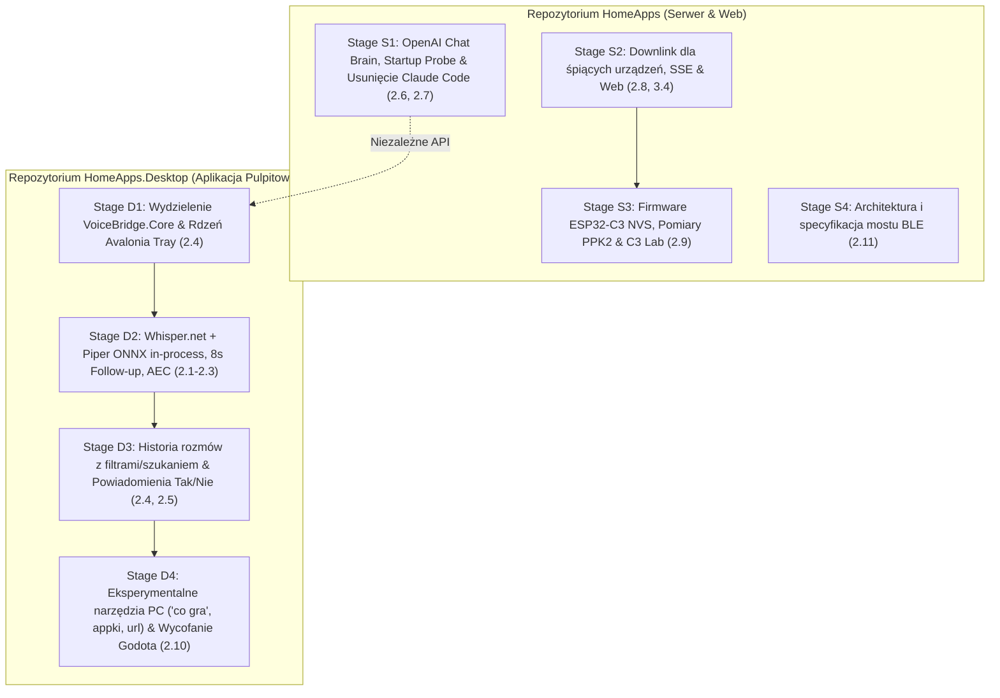

# ADR: JARVIS w tle na pulpicie, otwarte modele OpenAI i satelita ESP32-C3 (HomeApps & HomeApps.Desktop)

Target repo: ../HomeApps.Desktop (desktop stages) and this repo (server stages)  
**Specyfikacja:** [specs/jarvis-desktop-rework.md](file:///Users/adrianczubaty/Documents/RiderProjects/HomeApps/specs/jarvis-desktop-rework.md) · **Data:** 2026-11-27 · **Status:** accepted (rewizja po Devil's Advocate, odpowiedzi właściciela 2026-11-27)  
**Lead Architect:** backend-architect (`~/.agent-hub/agents/architect-backend.md`)  
**Repozytoria:**  
- **Serwer:** `HomeApps` (`/Users/adrianczubaty/Documents/RiderProjects/HomeApps`) — wymagania 2.6–2.9, 2.11  
- **Desktop:** `HomeApps.Desktop` (`/Users/adrianczubaty/Documents/RiderProjects/HomeApps.Desktop`) — wymagania 2.1–2.5, 2.10  

---

## 1. Rozstrzygnięte pytania i podjęte decyzje

### 1.1 Rozstrzygnięte pytania (odpowiedzi właściciela, 2026-11-27)

| # | Pytanie | Odpowiedź | Skutek |
|---|---|---|---|
| Q1 | Oczekujące ustawienie śpiącego urządzenia po „zaginione" | Czeka bezterminowo (A) | Brak wygasania `PendingSettings`; czyszczone tylko ramką `state` albo usunięciem urządzenia |
| Q2 | Kilka komputerów osoby słyszy to samo zdanie | Dzierżawa tury na serwerze (A) | Warunkowy blueprint D13 jest obowiązujący: 5 s lease, `409 turn_in_progress`, test wielu PC w S1 i D2 |
| Q3 | Narzędzia PC na macOS i Windows | Pełny parytet w 1.0 (A) | Wszystkie narzędzia 2.10 w D4 na obu platformach |
| Q4 | Usuwanie historii z pulpitu | Tylko podgląd (A) | Brak endpointu kasowania; retencja 7 dni |

### 1.2 Podjęte decyzje techniczne (Decisions Made)

1. **Wszystkie 10 uwag Devil's Advocate zweryfikowano bezpośrednio w kodzie i uznano za w pełni zasadne; brak fałszywych alarmów.**
2. **D1: Silnik `OpenAiChatBrain` zastępuje `ClaudeCodeBrain` (HomeApps, Wymaganie 2.7):**  
   *Powód:* Całkowita eliminacja procesu `claude -p`, tokenu subskrypcji Claude oraz środowiska Node.js w kontenerze. Zastosowanie bezpośredniego klienta HTTP zgodnego z API OpenAI `/v1/chat/completions` (poprzez `IHttpClientFactory` i strumieniowanie SSE `chat.completion.chunk`) z obsługą pętli tool callingu do `MaxTurns`.
3. **D2: Integracja narzędzi przez MCP over HTTP z poszanowaniem granic warstw (HomeApps, Wymaganie 2.7):**  
   *Powód:* `Jarvis.Infrastructure` nie może referencjonować `Jarvis.Api` (gdzie znajduje się `internal sealed class McpGateway`). `OpenAiChatBrain` łączy się z bramką narzędzi przez `HttpClient` / `McpClient` pod adresem `GatewayUrl` (np. `http://localhost:8080/jarvis/mcp`) przekazując nagłówki `Authorization: Bearer <GatewayToken>` oraz `X-Jarvis-Run: <RunId>`.
4. **D3: Egzekwowanie reguły odmowy 2.6 na poziomie promptu i walidacji (HomeApps, Wymaganie 2.6):**  
   *Powód:* Prompt systemowy w [Prompts.cs:9](file:///Users/adrianczubaty/Documents/RiderProjects/HomeApps/src/Jarvis/Jarvis.Application/Common/Prompts.cs#L9) zostaje zaktualizowany o twardą regułę odmowy spraw spoza HomeApps, pluginów, urządzeń i komputera: *„Pomagam tylko w sprawach domu w HomeApps, np. listy, plan, urządzenia. W czym mogę pomóc?”*.
5. **D4: Trwałość `PendingSettings` i downlink w `POST /devices/report` (HomeApps, Wymaganie 2.8):**  
   *Powód:* Usunięto błąd przedwczesnego zerowania oczekujących ustawień. Pobranie raportu zwraca kopię `PendingSettings` bez natychmiastowego czyszczenia do `NULL`. Pole jest czyszczone dopiero w `ApplyStateAsync` ([ProcessFramesHandler.cs:61](file:///Users/adrianczubaty/Documents/RiderProjects/HomeApps/src/Devices/Devices.Application/Frames/ProcessFrames/ProcessFramesHandler.cs#L61)), gdy przychodząca ramka `state` potwierdzi zaaplikowanie wartości (`ClearPendingSettingOnState`). Zapobiega to utracie etykiety „Czeka na urządzenie” przy retransmisjach lub zerwaniu odpowiedzi HTTP.
6. **D5: Odblokowanie kontrolek śpiących urządzeń w UI i w narzędziach JARVIS MCP (HomeApps, Wymaganie 2.8, 3.4):**  
   *Powód:* Znosimy blokadę w [DeviceCard.vue:67](file:///Users/adrianczubaty/Documents/RiderProjects/HomeApps/src/Web/src/features/devices/components/DeviceCard.vue#L67) i wyłączamy 20-sekundowy timeout. Rozszerzamy generator narzędzi MCP w [GeneratedTools.cs:57](file:///Users/adrianczubaty/Documents/RiderProjects/HomeApps/src/Devices/Devices.Application/Tools/GeneratedTools.cs#L57) na warunek `(online || parsed.Sleepy)`, dzięki czemu JARVIS może ustawiać kontrolki uśpionych urządzeń w dół.
7. **D6: Architektura Avalonia .NET 10 w `HomeApps.Desktop` oraz biblioteka `Jarvis.VoiceBridge.Core` (Wymagania 2.1–2.5, 2.10):**  
   *Powód:* Nowa aplikacja `src/HomeApps.Desktop/` (Avalonia 11, .NET 10) jako proces w zasobniku systemowym (menu bar macOS, system tray Windows). Z projektu [Jarvis.VoiceBridge.csproj](file:///Users/adrianczubaty/Documents/RiderProjects/HomeApps.Desktop/src/Jarvis.VoiceBridge/Jarvis.VoiceBridge.csproj) wydzielona zostaje biblioteka klas `Jarvis.VoiceBridge.Core`.
8. **D7: Startup Health Check oraz fail-fast LLM (Wymaganie 2.7):**  
   *Powód:* Zgodnie ze specyfikacją 2.7 dodajemy `IHostedService` weryfikujący dostępność modelu i obsługę narzędzi przy starcie serwisu (logujący jawny błąd w razie niepowodzenia). W runtime obowiązuje 15-sekundowy fail-fast: przy braku odpowiedzi model zwraca tekst i głos: *„JARVIS jest chwilowo niedostępny”*.
9. **D8: Potwierdzenia wyłącznie na ekranie Tak/Nie i eliminacja głosu "tak/nie" (Wymagania 2.3, 2.4):**  
   *Powód:* Specyfikacja 2.3 bezwzględnie wymaga potwierdzania akcji na ekranie (powiadomienie Tak/Nie), nie samym głosem — w obu trybach (słowo wybudzające i ciągły). Usuwamy instrukcję odpowiedzi głosem z [Prompts.cs:25](file:///Users/adrianczubaty/Documents/RiderProjects/HomeApps/src/Jarvis/Jarvis.Application/Common/Prompts.cs#L25) (`Prompts.Spoken`) i blokujemy akceptację "tak"/"nie" w pętli audio mostka desktopowego.
10. **D9: Pierwszorzędna autoryzacja powiadomień na pulpicie (Wymagania 2.3, 2.4):**  
    *Powód:* Naprawa błędu 403 `jarvis.forbidden` w [AssistantEndpoints.cs:41, 57](file:///Users/adrianczubaty/Documents/RiderProjects/HomeApps/src/Jarvis/Jarvis.Api/Endpoints/AssistantEndpoints.cs#L41). `OAuthLogin` aplikacji desktopowej pozyskuje token z audiensowością `homeapps` (lub endpointy potwierdzeń dopuszczają zweryfikowanego klienta desktopowego).
11. **D10: Całkowicie lokalne STT i TTS in-process bez Speaches (Wymagania 2.1, 2.2):**  
    *Powód:* Likwidacja zewnętrznego kontenera Speaches. STT realizowane przez `Whisper.net` (GGML base/tiny). TTS realizowane in-process za pomocą biblioteki Piper ONNX (`pl_PL-gosia-medium.onnx`), dzięki czemu przy połączeniu `?speech=local` aplikacja natychmiast odtwarza mowę lokalnie.
12. **D11: 8-sekundowe okno wypowiedzi po KAŻDEJ odpowiedzi (Wymaganie 2.1):**  
    *Powód:* Zgodnie ze specyfikacją 2.1 po każdej odpowiedzi asystenta następuje 8-sekundowe okno follow-up, w którym użytkownik może mówić bez słowa wybudzającego (nie tylko przy oczekiwaniu na akcję).
13. **D12: Pomiary zużycia energii C3 Power Lab z kompletem metryk i wariantem zerowym (Wymaganie 2.9):**  
    *Powód:* Włączenie pomiaru ciśnienia (pressure) obok temperatury i wilgotności. Przygotowanie dokumentacji z 5 wymaganymi metrykami (średni prąd, czas wysyłki, % udanych raportów, powrót po utracie Wi-Fi, liczba stanów silent) oraz testu z hotspotem telefonu bez zmian w firmware.
14. **D13: Warunkowy kontrakt centralnej dzierżawy tury (Turn Lease) dla Q2(A):**  
    *Powód:* Zabezpieczenie przed jednoczesną odpowiedzią wielu komputerów tej samej osoby w jednym pokoju poprzez 5-sekundową dzierżawę w pamięci podręcznej serwera `Jarvis`.

---

### 1.3 Konflikty rozstrzygnięte (Resolved Conflicts)

1. **Czyszczenie `PendingSettings`:** Odrzucono zerowanie przy pobieraniu `/report` (które niszczyło wskaźnik UI w razie problemów z siecią) na rzecz idempotentnego czyszczenia w momencie nadejścia potwierdzającej ramki `state` (`ClearPendingSettingOnState`).
2. **Autoryzacja potwierdzeń z poziomu Desktopu:** Rozwiązano konflikt audiensowości tokenu OAuth między `https://<domain>/jarvis/mcp` a wymaganym przez [AssistantEndpoints.cs:70](file:///Users/adrianczubaty/Documents/RiderProjects/HomeApps/src/Jarvis/Jarvis.Api/Endpoints/AssistantEndpoints.cs#L70) `JwtOptions.Audience` (`"homeapps"`).
3. **Potwierdzenia akcji destrukcyjnych:** Zgodnie ze specyfikacją 2.3 wyłączono potwierdzenia głosowe "tak/nie" w obu trybach pracy (słowo wybudzające oraz nasłuch ciągły). Potwierdzenie wymaga kliknięcia w powiadomienie systemowe lub okno historii.
4. **Synteza mowy na pulpicie (TTS):** Zastąpiono zewnętrzne zapytania HTTP do Speaches in-processowym silnikiem Piper ONNX w `Jarvis.VoiceBridge.Core`, zapewniając pełną autonomię audio bez kontenerów dockera.
5. **Dostęp JARVIS-a do uśpionych urządzeń:** Zniesiono blokadę `online` w [GeneratedTools.cs:57](file:///Users/adrianczubaty/Documents/RiderProjects/HomeApps/src/Devices/Devices.Application/Tools/GeneratedTools.cs#L57) dla urządzeń śpiących (`parsed.Sleepy`), umożliwiając asystentowi zlecanie zmian parametrów.

---

## 2. Kontrakt API, model danych i Developer Implementation Blueprint

### 2.1 Podział własności per repozytorium i etapowanie



---

### 2.2 Kontrakty API i protokoły sieciowe

#### A. Wymaganie 2.7: Konfiguracja OpenAI i Startup Health Check (Serwer `Jarvis`)

Opcje konfiguracji `src/Jarvis/Jarvis.Infrastructure/Brain/OpenAiChatOptions.cs`:
```csharp
namespace Jarvis.Infrastructure.Brain;

public sealed class OpenAiChatOptions
{
    public const string SectionName = "Jarvis:OpenAi";

    public string BaseUrl { get; set; } = string.Empty;
    public string Model { get; set; } = string.Empty;
    public string? ApiKey { get; set; }
    public int MaxTurns { get; set; } = 8;
    public string GatewayUrl { get; set; } = "http://localhost:8080/jarvis/mcp";
    public TimeSpan Timeout { get; set; } = TimeSpan.FromSeconds(15);
}
```

**Startup Health Probe (`OpenAiModelHealthCheck` / `IHostedService`):**
Przy starcie serwera weryfikuje reachability:
- Wysyła żądanie testowe `GET ${BaseUrl}/models` lub minimalne zapytanie completions z dummy tool.
- W razie błędu loguje błąd krytyczny `JARVIS model unavailable or lacks tool calling support`.
- W runtime przy niedostępności model natychmiast zwraca: *„JARVIS jest chwilowo niedostępny”*.

#### B. Wymaganie 2.6 i 2.3: Prompt systemowy i potwierdzenia na ekranie
W [Prompts.cs:9-27](file:///Users/adrianczubaty/Documents/RiderProjects/HomeApps/src/Jarvis/Jarvis.Application/Common/Prompts.cs#L9-L27):
```csharp
public const string ScopeRefusalRule = """
    ZASADA ZAKRESU (BEZWZGLĘDNA): Pomagasz wyłącznie w sprawach HomeApps, pluginów (Todo, Chat itp.),
    urządzeń smart home oraz komputera użytkownika (gdy dostępne narzędzia PC).
    Na wszelkie prośby ogólne, niezwiązane z domem (np. pisanie wypracowań, generowanie kodu niezwiązanego z domem,
    kursy kryptowalut, wiedza ogólna o świecie) ODMAWIASZ jednym krótkim zdaniem:
    "Pomagam tylko w sprawach domu w HomeApps, np. listy, plan, urządzenia. W czym mogę pomóc?"
    i NIE wywołujesz żadnych narzędzi.
    """;

public const string Spoken = """
    Ta rozmowa jest głosowa: twoja odpowiedź zostanie przeczytana na głos. Mów jednym do trzech krótkich zdań,
    bez list, tabel, emoji, linków i identyfikatorów. Daty i godziny podawaj tak, jak się je mówi.
    Gdy akcja czeka na potwierdzenie, poinformuj krótko, że wymaga potwierdzenia na ekranie.
    """;
```

#### C. Wymaganie 2.8: Downlink ustawień i obsługa śpiących urządzeń

**1. `POST /devices/v1/report` ([DeviceStateEndpoints.cs:57](file:///Users/adrianczubaty/Documents/RiderProjects/HomeApps/src/Devices/Devices.Api/Endpoints/DeviceStateEndpoints.cs#L57)):**
- Odpowiedź zawiera pole `settings` z oczekującymi wartościami.
- Serwer **nie zeruje** `PendingSettings` w bazie danych w momencie odesłania odpowiedzi.

**2. `POST /devices/v1/{deviceId}/set` ([DeviceStateEndpoints.cs:52](file:///Users/adrianczubaty/Documents/RiderProjects/HomeApps/src/Devices/Devices.Api/Endpoints/DeviceStateEndpoints.cs#L52)):**
- Dla urządzenia śpiącego (`descriptor.Sleepy == true`) zapisuje wartość do `DeviceState.PendingSettings`.
- Publikuje zdarzenie SSE: `{ "type": "changed", "data": { "deviceId": "...", "reason": "pending_settings" } }`.

**3. Kontrakty DTO i SSE:**
- Backend: [DeviceStateView.cs:6](file:///Users/adrianczubaty/Documents/RiderProjects/HomeApps/src/Devices/Devices.Application/Common/DeviceStateView.cs#L6):
  ```csharp
  public sealed record DeviceStateView(
      Guid DeviceId,
      JsonElement Values,
      DateTimeOffset? ValuesAt,
      bool Online,
      bool Silent,
      bool LowBattery,
      DateTimeOffset? LastStatusAt,
      double? Battery,
      double? Voltage,
      int? Rssi,
      long? Uptime,
      string? Firmware,
      string? Error,
      JsonElement? PendingSettings = null);
  ```
- SSE Typy [stream.ts:4-12](file:///Users/adrianczubaty/Documents/RiderProjects/HomeApps/src/Web/src/features/devices/stream.ts#L4-L12):
  ```typescript
  export type DeviceStreamChangedReason =
    | 'renamed'
    | 'jarvis'
    | 'notes'
    | 'removed'
    | 'restored'
    | 'paired'
    | 'descriptor'
    | 'pending_settings'
  ```
- Narzędzia JARVIS [GeneratedTools.cs:57](file:///Users/adrianczubaty/Documents/RiderProjects/HomeApps/src/Devices/Devices.Application/Tools/GeneratedTools.cs#L57):
  ```csharp
  if ((online || (DescriptorParser.Parse(device.Descriptor) is { IsSuccess: true, Value.Sleepy: true }))
      && !Blocks(device, jarvisCaller) && Controls(device) is { Count: > 0 } controls)
  ```

#### D. Autoryzacja potwierdzeń na pulpicie (Wymaganie 2.3, 2.4)
- `OAuthLogin` na pulpicie żąda tokenu pierwszorzędnego dla zasobu/odbiorcy `homeapps`:
  `&resource=homeapps` (lub rejestracja natywnego klienta desktopowego z dozwolonym audience `homeapps`).
- [AssistantEndpoints.cs:67-70](file:///Users/adrianczubaty/Documents/RiderProjects/HomeApps/src/Jarvis/Jarvis.Api/Endpoints/AssistantEndpoints.cs#L67-L70): Endpointy `/jarvis/api/v1/confirmations` akceptują tokeny desktopowe, umożliwiając wykonywanie akcji Tak/Nie z toastów i okna historii bez błędu `403 jarvis.forbidden`.

#### E. [WARUNKOWY BLUEPRINT Q2(A)] Centralna dzierżawa tury (Turn Lease)
Jeśli właściciel zatwierdzi rekomendację Q2(A):
- **Zasada:** Wypowiedź z komputera rezerwuje klucz `turn_lease:{userId}` w `IMemoryCache` / Redis na 5 sekund.
- **WebSocket `/jarvis/voice`:**
  - Przy zdarzeniu `start` lub `say` serwer sprawdza, czy inny klient posiada aktywną dzierżawę tury.
  - Jeśli dzierżawa należy do innej sesji: serwer wysyła zdarzenie `{ "type": "lease_conflict", "code": "turn_in_progress" }` (odpowiednik HTTP 409).
  - Klient desktopowy natychmiast przerywa nagrywanie/wysyłanie i lokalnie milknie.
  - Zakończenie tury (`done` / `cancel`) zwalnia dzierżawę przed upływem 5 sekund.

---

### 2.3 Model danych i migracje

#### Serwis `Devices` (Baza `homeapps_devices`)
- Tabela `DeviceStates` ([DeviceState.cs](file:///Users/adrianczubaty/Documents/RiderProjects/HomeApps/src/Devices/Devices.Domain/Devices/DeviceState.cs)):
  - Nowa kolumna: `PendingSettings` (`text`, nullable, domyślnie `NULL`).
  - Metoda `SetPendingSetting(string control, JsonElement value)`: aktualizuje słownik oczekujących wartości.
  - Metoda `GetPendingSettingsForReport()`: zwraca kopię słownika do wysłania w `/report` bez zerowania stanu w bazie.
  - Metoda `ClearPendingSettingOnState(JsonElement reportedValues)`: wywoływana w `ApplyStateAsync` po nadejściu ramki `state`. Sprawdza klucze zgłoszone przez urządzenie; jeśli wartość została zaktualizowana, usuwa dany wpis z `PendingSettings`.
  - Migracja EF Core: `DeviceStatePendingSettings`.

#### Serwis `Jarvis` (Baza `homeapps_jarvis`)
- Historia wiadomości: dodanie pola `Channel` (`app` | `voice` | `desktop`) w widoku wiadomości (`MessageView`), umożliwiającego filtrowanie po kanale w oknie historii rozmów (wymaganie 2.5).

---

### 2.4 Developer Implementation Blueprint

#### Repozytorium `HomeApps` (Serwer & Web)

1. **Kompletne usunięcie Claude Code i tokenów subskrypcji:**
   - [Dockerfile:9-15](file:///Users/adrianczubaty/Documents/RiderProjects/HomeApps/src/Jarvis/Jarvis.Api/Dockerfile#L9-L15): Usunięcie Node.js, npm oraz `@anthropic-ai/claude-code`.
   - [compose.prod.yaml:248-253](file:///Users/adrianczubaty/Documents/RiderProjects/HomeApps/compose.prod.yaml#L248-L253) oraz [compose.dev.yaml:328-331](file:///Users/adrianczubaty/Documents/RiderProjects/HomeApps/compose.dev.yaml#L328-L331): Zastąpienie `Jarvis__ClaudeCode__*` zmiennymi `Jarvis__OpenAi__BaseUrl`, `Jarvis__OpenAi__Model`, `Jarvis__OpenAi__ApiKey`.
   - [.env.example:36-37](file:///Users/adrianczubaty/Documents/RiderProjects/HomeApps/.env.example#L36-L37) i [.env.prod.example:62-64](file:///Users/adrianczubaty/Documents/RiderProjects/HomeApps/.env.prod.example#L62-L64): Usunięcie `JARVIS_CLAUDE_CODE_OAUTH_TOKEN` i `JARVIS_CLAUDE_MODEL`, dodanie zmiennych `JARVIS_MODEL_*`.
   - [appsettings.json:42-49](file:///Users/adrianczubaty/Documents/RiderProjects/HomeApps/src/Jarvis/Jarvis.Api/appsettings.json#L42-L49) i [appsettings.Development.json:40-42](file:///Users/adrianczubaty/Documents/RiderProjects/HomeApps/src/Jarvis/Jarvis.Api/appsettings.Development.json#L40-L42): Usunięcie sekcji `ClaudeCode`, dodanie konfiguracji `OpenAi`.
   - [docs/deployment.md:69](file:///Users/adrianczubaty/Documents/RiderProjects/HomeApps/docs/deployment.md#L69) i [docs/jarvis.md:174-195](file:///Users/adrianczubaty/Documents/RiderProjects/HomeApps/docs/jarvis.md#L174-L195): Usunięcie referencji do Claude Code token.
   - Usunięcie plików: `ClaudeCodeBrain.cs`, `ClaudeCodeOptions.cs`, `StreamJsonReader.cs` oraz testu `tests/Jarvis/Jarvis.Api.Tests/StreamJsonReaderTests.cs`. Zachowanie `FakeBrain.cs` dla testów API.

2. **Silnik `OpenAiChatBrain` w `Jarvis.Infrastructure`:**
   - Nowy plik: `src/Jarvis/Jarvis.Infrastructure/Brain/OpenAiChatBrain.cs`.
   - Pobieranie listy narzędzi i wywołania `tool_calls` przez `HttpClient` do `GatewayUrl` (`/jarvis/mcp`) z nagłówkiem `X-Jarvis-Run` i tokenem `request.GatewayToken` (brak nielegalnej referencji do warstwy `Jarvis.Api`).
   - Rejestracja `OpenAiModelHealthCheck` uruchamianego na starcie serwisu.

3. **Downlink i odblokowanie kontroli w `Devices`:**
   - [DeviceState.cs](file:///Users/adrianczubaty/Documents/RiderProjects/HomeApps/src/Devices/Devices.Domain/Devices/DeviceState.cs): Metody zarządzania `PendingSettings`.
   - [ProcessFramesHandler.cs:23-58](file:///Users/adrianczubaty/Documents/RiderProjects/HomeApps/src/Devices/Devices.Application/Frames/ProcessFrames/ProcessFramesHandler.cs#L23-L58): Przekazanie kopii `PendingSettings` w `ReportResponseView`; czyszczenie potwierdzonych kluczy w `ApplyStateAsync`.
   - [DeviceStateEndpoints.cs:52](file:///Users/adrianczubaty/Documents/RiderProjects/HomeApps/src/Devices/Devices.Api/Endpoints/DeviceStateEndpoints.cs#L52): Obsługa `POST /devices/{id}/set` dla urządzeń śpiących.
   - [DeviceStateView.cs:6](file:///Users/adrianczubaty/Documents/RiderProjects/HomeApps/src/Devices/Devices.Application/Common/DeviceStateView.cs#L6) oraz [GetDeviceStateHandler.cs:23](file:///Users/adrianczubaty/Documents/RiderProjects/HomeApps/src/Devices/Devices.Application/Telemetry/GetDeviceState/GetDeviceStateHandler.cs#L23): Przekazanie `PendingSettings` do widoku stanu urządzenia.
   - [GeneratedTools.cs:57](file:///Users/adrianczubaty/Documents/RiderProjects/HomeApps/src/Devices/Devices.Application/Tools/GeneratedTools.cs#L57): Udostępnienie akcji `_set` dla urządzeń z `descriptor.Sleepy`.

4. **Web Frontend (`src/Web`):**
   - [stream.ts:4-12](file:///Users/adrianczubaty/Documents/RiderProjects/HomeApps/src/Web/src/features/devices/stream.ts#L4-L12): Dodanie `'pending_settings'` do `DeviceStreamChangedReason`.
   - [api.ts:62-76](file:///Users/adrianczubaty/Documents/RiderProjects/HomeApps/src/Web/src/features/devices/api.ts#L62-L76): Pole `pendingSettings` w `DeviceStateInfo`.
   - [DeviceCard.vue:67, 101](file:///Users/adrianczubaty/Documents/RiderProjects/HomeApps/src/Web/src/features/devices/components/DeviceCard.vue#L67): Zniesienie blokady śpiących urządzeń i wyłączenie 20-sekundowego fałszywego błędu braku odpowiedzi.
   - [ControlWidget.vue](file:///Users/adrianczubaty/Documents/RiderProjects/HomeApps/src/Web/src/features/devices/components/ControlWidget.vue): Etykieta *„Czeka na urządzenie”*, blokada ponownych kliknięć i atrybut `aria-busy="true"`.

5. **C3 Power Lab i Firmware ESP-IDF (`firmware/tests/c3-power-lab/`):**
   - Emulacja losowych odczytów sensora: temperatura, wilgotność, **ciśnienie (pressure)** oraz bateria.
   - Pomiary prądu i raport zawierający 5 metryk:
     1. Średni prąd (average current).
     2. Czas od wybudzenia do wysłania raportu (wake-to-send time).
     3. Odsetek udanych raportów (% of successful reports).
     4. Czas powrotu do normalnej pracy po utracie Wi-Fi.
     5. Liczba przejść w stan `silent` („zaginione”) na serwerze.
     - Rekomendacja trybu zasilania dla urządzenia bateryjnego.
   - Wariant zerowy: Scenariusz testowy z wykorzystaniem hotspotu ze smartfona bez żadnych modyfikacji w kodzie źródłowym firmware'u.

---

#### Repozytorium `HomeApps.Desktop` (Aplikacja Pulpitowa Avalonia)

1. **Projekt i biblioteka `Jarvis.VoiceBridge.Core`:**
   - Przekształcenie `Jarvis.VoiceBridge` w bibliotekę klas współdzieloną z nowym projektem `src/HomeApps.Desktop/` (Avalonia 11, .NET 10).
2. **Tray i interakcja systemowa:**
   - `TrayIconManager.cs` ze stanami animowanymi i poszanowaniem flagi *prefers-reduced-motion*.
   - Globalny skrót klawiszowy wyciszenia mikrofonu (wymaganie 2.3).
3. **Silnik audio i nasłuchu:**
   - STT in-process: `Whisper.net` (GGML).
   - TTS in-process: Piper ONNX (`pl_PL-gosia-medium.onnx`) w `Jarvis.VoiceBridge.Core` — pełna autonomia audio na pulpicie.
   - 8-sekundowe okno wypowiedzi po KAŻDEJ odpowiedzi asystenta (wymaganie 2.1).
   - Filtr AEC (Acoustic Echo Cancellation) na buforze odtwarzania TTS umożliwiający przerwanie mowy komendą „stop” / „cisza”.
4. **Powiadomienia Tak/Nie i autoryzacja:**
   - WinRT Toast (Windows) oraz `UNUserNotificationCenter` (macOS).
   - Zgoda wyłącznie na ekranie — usunięcie obsługi głosu "tak/nie" w obu trybach nasłuchu.
   - Pozyskiwanie tokenu z uprawnieniem do `/jarvis/api/v1/confirmations`.
5. **Historia rozmów (Wymaganie 2.5):**
   - `HistoryWindow.axaml` z filtrami dnia, filtrem kanału (`app`, `voice`, `desktop`), polem wyszukiwania (`?q=`), prezentacją wywołanych narzędzi wraz z wynikiem potwierdzenia oraz dolnym polem wprowadzania tekstu.
6. **Eksperymentalne narzędzia PC (Wymaganie 2.10):**
   - [ComputerActions.cs:1-20](file:///Users/adrianczubaty/Documents/RiderProjects/HomeApps.Desktop/src/Jarvis.VoiceBridge/ComputerActions.cs#L1-L20): Obsługa 6 kontrolek w ustawieniach: uruchamianie aplikacji, otwieranie URL, kontrola multimediów, **narzędzie odczytu „co gra” (read-only current track)**, regulacja głośności oraz minutniki.

---

### 2.5 Niezmienniki współbieżności, limitów czasu i obsługi awarii

1. **Bramka pojedynczej wypowiedzi (Turn Lock):** `SemaphoreSlim(1, 1)` w pętli audio; AEC wyłapuje wyłącznie słowa przerwania podczas odtwarzania TTS.
2. **Fail-closed dla narzędzi komputera:** Wywołanie akcji PC z satelity jest odrzucane w [McpGateway.cs:158](file:///Users/adrianczubaty/Documents/RiderProjects/HomeApps/src/Jarvis/Jarvis.Api/Gateway/McpGateway.cs#L158).
3. **Idempotentność i retencja downlinku:** Zmiany wartości w `PendingSettings` działają w trybie „ostatnia wartość wygrywa”. Oczekujące ustawienie jest czyszczone dopiero po potwierdzeniu przez ramkę `state`.
4. **Fail-fast API OpenAI:** Sztywny 15-sekundowy timeout; błędy natychmiast zwracają komunikat o chwilowej niedostępności.
5. **Dzierżawa tury wielu stacji [Q2(A)]:** Pierwsza stacja rezerwuje 5-sekundowy token tury; pozostałe maszyny po odebraniu `lease_conflict` natychmiast milkną.

---

## 3. Ryzyka i scenariusze testowe

### 3.1 Główne ryzyka techniczne i architektoniczne

1. **Stabilność Tool Callingu w modelach lokalnych:** Modele poniżej 8B parametrów mogą zniekształcać JSON argumentów. `OpenAiChatBrain` waliduje argumenty schematem JSON i daje modelowi jedną szansę na autorefleksję w razie błędu parsowania.
2. **Pobór prądu ESP32-C3:** Pomiary na płytkach deweloperskich z mostkami USB fałszują wyniki. Pomiary PPK2 należy prowadzić po odcięciu diody i konwertera USB bezpośrednio na szynie 3.3V.
3. **Współbieżność wielu maszyn:** Wypowiedź w pokoju z kilkoma laptopami mogłaby wywołać kakofonię. Dzierżawa tury na serwerze (Q2) eliminuje ten problem.

---

### 3.2 Wymagane scenariusze testowe

#### Serwer (`HomeApps` — testy xUnit)
- `tests/Jarvis/Jarvis.Api.Tests` (oraz testy integracyjne Jarvis):
  1. Strumieniowanie tekstu SSE i poprawne wywołanie narzędzia MCP przez HTTP gateway.
  2. Pętla wielu narzędzi w limicie `MaxTurns`.
  3. Brak konfiguracji URL/modelu zwraca natychmiast *„JARVIS jest teraz wyłączony”*.
  4. Startup Health Check: symulacja niedostępnego modelu loguje błąd krytyczny przy starcie serwisu.
  5. Timeout 15 s z API OpenAI zwraca komunikat *„JARVIS jest chwilowo niedostępny”*.
  6. Weryfikacja reguły odmowy 2.6: zapytanie ogólne zwraca standardową odmowę bez wywoływania narzędzi MCP.
  7. **[WARUNKOWY TEST Q2(A)] Test wielostacyjny:** Dwie sesje wysyłają żądanie jednocześnie; pierwsza rezerwuje dzierżawę tury, druga otrzymuje kod błędu `409 turn_in_progress` / zdarzenie `lease_conflict`.
- `Devices.Application.Tests`:
  1. `SetControlCommand` dla urządzenia `sleepy: true` zapisuje stan w `PendingSettings` i publikuje zdarzenie SSE `'pending_settings'`.
  2. `POST /devices/report` zwraca oczekujące ustawienie w odpowiedzi, ale **nie czyści** `PendingSettings` w bazie.
  3. Przyjście ramki `state` z zaaplikowaną wartością czyści dany klucz z `PendingSettings`.
  4. Nadpisanie kontrolki przed raportem aktualizuje pożądany stan (brak kolejkowania FIFO).

#### Web Frontend (`src/Web` — testy Vitest)
- `DeviceCard.spec.ts` & `ControlWidget.spec.ts`:
  1. Kontrolka śpiącego urządzenia nie jest blokowana przez `sleepyLocked` ani stan offline.
  2. Kliknięcie kontrolki nie wyzwala fałszywego 20-sekundowego błędu timeoutu.
  3. Wyświetlenie etykiety *„Czeka na urządzenie”* oraz atrybutu `aria-busy="true"`.
  4. Odbiór ramki `state` na strumieniu SSE usuwa wskaźnik oczekiwania.

#### Firmware (`firmware/tests/c3-power-lab/`)
- Aplikacja testowa ESP-IDF:
  1. Cykl pomiarowy sensorów: temperatura, wilgotność, ciśnienie, bateria.
  2. Raportowanie 5 metryk zużycia energii i stabilności (w tym czas powrotu po utracie Wi-Fi i odsetek sukcesu).
  3. Scenariusz zerowy: weryfikacja stabilności raportowania przez hotspot mobilny bez zmian w firmware.

#### Pulpit (`HomeApps.Desktop` — testy Avalonia / Unit)
- `Jarvis.Desktop.Tests`:
  1. `TrayIconManagerTests`: przejścia stanów ikony oraz wyłączenie animacji przy `prefers-reduced-motion`.
  2. `AudioEngineTests`: weryfikacja in-process TTS (Piper ONNX) oraz STT (Whisper.net).
  3. `FollowUpWindowTests`: weryfikacja, że 8-sekundowe okno nasłuchu otwiera się po każdej zakończonej odpowiedzi asystenta.
  4. `ConfirmationAuthTests`: weryfikacja, że akcja Tak/Nie wysyła token z właściwym audience i otrzymuje kod 200 OK z serwera.
  5. `VoiceConfirmationDisabledTests`: słowa "tak"/"nie" wypowiedziane do mikrofonu są ignorowane; potwierdzenie wymaga kliknięcia.
  6. `HistoryViewTests`: poprawne działanie filtrów dnia i kanału, wyszukiwarki oraz dolnego pola tekstowego.
  7. `ComputerActionsTests`: weryfikacja działania 6 narzędzi PC (w tym nowego narzędzia odczytu „co gra”).
  8. **[WARUNKOWY TEST Q2(A)]**: Odebranie zdarzenia `lease_conflict` powoduje natychmiastowe przejście mostka w stan uśpienia/milczenia bez generowania dźwięku.

---

## 4. Zakres odrzucony i odłożony (Rejected and Deferred Scope)

1. **Overlay i hologram 3D na ekranie:** Odrzucone bezwzględnie. Aplikacja desktopowa działa wyłącznie w tle jako ikona w zasobniku systemowym (menu bar / system tray).
2. **Działająca aplikacja mobilna (iOS/Android) jako most BLE:** Odłożone poza bieżącą wersję (Wymaganie 2.11 obejmuje wyłącznie specyfikację GATT i wymienny komponent firmware).
3. **Inwazyjne narzędzia PC o wysokim ryzyku prywatności:** Odczyt schowka, automatyczne zrzuty ekranu oraz globalne keyloggery są wykluczone z bieżącej wersji.
4. **Kolejkowanie poleceń (FIFO) dla urządzeń śpiących:** Odrzucone. Obowiązuje semantyka stanu pożądanego („ostatnia wartość wygrywa”).
5. **Autoryzacja głosowa akcji potwierdzanych („tak”/„nie”):** Odrzucone bezwzględnie w obu trybach (słowo wybudzające i ciągły). Wszystkie potwierdzenia wymagają fizycznej interakcji na ekranie.
